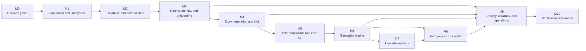

# Whodunit v0.1 MVP — Implementation Task List

This is the execution backlog for the product defined in
[requirements.md](./requirements.md) and
[technical-design.md](./technical-design.md). The requirements document is the
product source of truth; the technical design defines the intended
implementation. If either document changes, update the affected tasks and
traceability before implementation continues.

## 1. How to Use This Backlog

- Complete the decision gates in Milestone 0 before starting the tasks they
  block.
- A task may start only when all items in its **Depends on** field are complete.
- Tasks whose dependencies are satisfied may run in parallel, even when they
  appear in different sections.
- Check a task only after its stated **Done when** condition and focused tests
  pass.
- Every implementation pull request must link its task ID and the applicable
  requirement or technical-design section.
- New migrations, commands, projections, and API contracts must include tests
  in the same change. The final verification milestone adds cross-feature
  coverage; it is not a substitute for task-level testing.
- Do not weaken the dedicated-Game-Master, immutable-story, projection, or
  privacy invariants to make a feature easier to ship.

### Status legend

- [x] Complete and verified.
- [ ] Not complete.
- **Gate** means a product or operational decision that must be recorded before
  dependent implementation begins.
- **Critical path** means the shortest dependency chain to a playable game.

### Global definition of done

Unless a task says otherwise, it is complete only when:

1. The implementation matches the requirements and technical design.
2. Types, validation, authorization, failure behavior, and observability are
   included.
3. Unit, database, contract, integration, or UI tests appropriate to the risk
   pass locally and in CI.
4. No secret or private actor data is sent to the wrong client, cache, log,
   Realtime payload, analytics event, or model context.
5. Mobile behavior, loading, empty, error, stale-state, and retry states have
   been considered.
6. User-facing copy is accessible, Unicode-safe, and does not assume the host
   is a player.
7. Relevant documentation and requirement traceability are updated.

## 2. Delivery Roadmap

The critical path is:

**foundation → database invariants → identity/onboarding → generation and
atomic lock → actor projections → command kernel → gameplay → interventions →
endgame → release verification**

## 3. Milestone 0 — Decisions and Delivery Guardrails

### M0 exit criteria

Every decision that changes a database constraint, readiness rule, scoring
result, retention job, or release commitment is recorded in the requirements
or technical design. No dependent task relies on an undocumented assumption.

- [x] **M0-01 — Establish the v0.1 product and architecture baseline**
  - **Depends on:** None.
  - **Deliverable:** Reviewed requirements and comprehensive technical design
    for a dedicated non-playing Game Master and 4–12 players.
  - **Done when:** The baseline is versioned in Git and all confirmed decisions
    agree across both documents.

- [x] **M0-02 — Finalize the description-completeness rule**
  - **Depends on:** M0-01.
  - **Deliverable:** Define the required all-other-player description matrix,
    how decline/skip exceptions work without removing the prompt for every
    other player, and what exact condition makes a room generation-ready.
  - **Done when:** The rule, validation copy, and readiness calculation are
    documented with 4-player and 12-player examples.
  - **Blocks:** IDN-13, GEN-03.

- [x] **M0-03 — Finalize claim and replacement state rules**
  - **Depends on:** M0-01.
  - **Deliverable:** Allowed room states for initial claims, host rejection,
    active-membership revocation, reconnect requests, and device replacement.
  - **Done when:** A transition table covers every room state and simultaneous
    requests.
  - **Blocks:** IDN-06, IDN-08.

- [x] **M0-04 — Approve scoring weights and awards**
  - **Depends on:** M0-01.
  - **Deliverable:** Version 1 point weights, multi-murderer partial credit,
    deterministic early-deduction bonus rules, tie behavior, and fun awards.
    The profile must preserve the already-fixed faction outcomes: innocents win
    only by identifying every murderer, murderers win when at least one escapes
    identification, and accomplices share the murderers' outcome.
  - **Done when:** Worked examples produce unambiguous scores and the approved
    profile is added to the technical design.
  - **Blocks:** DB-13, END-04.

- [x] **M0-05 — Decide accusation closing and non-submitter behavior**
  - **Depends on:** M0-01.
  - **Deliverable:** Whether the Game Master can close intake before all
    players submit, the confirmations required, and how non-submitters score.
  - **Done when:** The normal, early-close, disconnected-player, and zero-submit
    cases are documented.
  - **Blocks:** END-02, END-04.

- [x] **M0-06 — Finalize incomplete-room retention**
  - **Depends on:** M0-01.
  - **Deliverable:** Retention and recovery policy for DRAFT, LOBBY,
    GENERATING, READY_TO_START, IN_PROGRESS, FINAL_ACCUSATIONS, and REVEAL.
    Completed-room deletion remains fixed at 30 days.
  - **Done when:** Every room state has an inactivity clock, recovery behavior,
    deletion behavior, and user warning.
  - **Blocks:** REL-06.

- [x] **M0-07 — Choose the MVP language policy**
  - **Depends on:** M0-01.
  - **Deliverable:** Record English-only or English plus an optional Hindi copy
    layer while retaining Unicode-safe names and culturally inclusive Indian
    contexts.
  - **Done when:** Supported interface languages, fallback behavior, and
    localization ownership are documented.
  - **Blocks:** UX-02, QA-08.

- [x] **M0-08 — Set release and operating targets**
  - **Depends on:** M0-01.
  - **Deliverable:** Supported mobile browsers, minimum viewport, target
    Supabase/Vercel region, generation and intervention latency budgets,
    monthly AI spend guardrails, and initial room concurrency target.
  - **Done when:** Targets are measurable and each has an owner and release
    gate.
  - **Blocks:** FND-08, INT-04, OPS-03, QA-07.

- [x] **M0-09 — Create requirement-to-task traceability**
  - **Depends on:** M0-02 through M0-08.
  - **Deliverable:** Map every committed requirement to one or more task and
    verification IDs.
  - **Done when:** No requirement is uncovered and no task introduces behavior
    outside the approved MVP. The global definition of done keeps the matrix
    current at every later milestone.

## 4. Milestone 1 — Foundation and UX System

### M1 exit criteria

A clean checkout builds and tests in CI; server-only dependencies cannot enter
the client bundle; the actor journeys, privacy copy, and mobile UI primitives
are ready for feature work.

- [x] **FND-01 — Scaffold the application**
  - **Depends on:** M0-01.
  - **Deliverable:** Next.js App Router, TypeScript, Tailwind CSS, package
    scripts, and the module boundaries prescribed by technical design section
    24.
  - **Done when:** A clean install, development start, and production build
    succeed.

- [x] **FND-02 — Configure code-quality tooling**
  - **Depends on:** FND-01.
  - **Deliverable:** Formatting, linting, strict type checking, import-boundary
    rules, and pre-commit or CI checks.
  - **Done when:** The pipeline rejects client imports of service-role,
    recovery-secret, or OpenAI modules.

- [x] **FND-03 — Add typed environment validation**
  - **Depends on:** FND-01.
  - **Deliverable:** Validated public/server environment schemas, Supabase
    clients, OpenAI provider configuration, model IDs, webhook secrets, and
    environment-specific defaults.
  - **Done when:** Startup fails safely on missing or malformed configuration
    and no server secret appears in a browser bundle.

- [x] **FND-04 — Define shared domain contracts**
  - **Depends on:** FND-01.
  - **Deliverable:** Branded room/player/membership/story IDs; lifecycle,
    membership, mission, and accusation enums; stable error envelope;
    idempotency-key and state-version contracts.
  - **Done when:** Invalid ID mixing and illegal state transitions fail type or
    unit validation.

- [x] **FND-05 — Establish the local database and test harness**
  - **Depends on:** FND-03, FND-04.
  - **Deliverable:** Local Supabase workflow, reset/migration command, database
    test runner, API integration harness, deterministic clocks, and fixture
    factories.
  - **Done when:** A clean worker recreates the database and runs a smoke test
    without manual setup.

- [ ] **FND-06 — Build continuous integration**
  - **Depends on:** FND-02, FND-05.
  - **Deliverable:** CI jobs for formatting, lint, type check, migrations,
    database tests, application tests, and production build.
  - **Done when:** Required checks run on every pull request and failures block
    merging.

- [x] **UX-01 — Map the two-actor experience**
  - **Depends on:** M0-01.
  - **Deliverable:** Mobile-first journey and information architecture for the
    Game Master and players across every room state, including recovery,
    disconnect, conflict, and generation failure.
  - **Done when:** Every route has one actor, entry condition, exit condition,
    empty/loading/error state, and back-navigation rule; the Game Master never
    receives player-only UI.

- [x] **UX-02 — Finalize privacy, consent, and gameplay copy**
  - **Depends on:** M0-02, M0-07, UX-01.
  - **Deliverable:** Copy for room-code disclosure, claim approval, device
    replacement, private descriptions, Game Master visibility, notebook and
    draft privacy, AI use, generation wait, and 30-day completed-room expiry.
  - **Done when:** Copy accurately distinguishes raw inputs, owner-only drafts,
    submitted gameplay state, and the full post-lock GameMasterView.

- [x] **UI-01 — Create the mobile design system**
  - **Depends on:** FND-01, UX-01.
  - **Deliverable:** Tokens and accessible components for forms, player cards,
    status badges, secrets, dialogs, toasts, timelines, evidence, missions,
    tabs, and sticky actions.
  - **Done when:** Components meet contrast/focus/touch-target requirements and
    survive long Unicode names, duplicate names, narrow phones, and desktop
    Game Master layouts.

- [x] **FND-07 — Add typed API and form infrastructure**
  - **Depends on:** FND-04, UI-01.
  - **Deliverable:** Typed request helpers, schema-backed forms, normalized
    errors, idempotency keys, optimistic-state conventions, and 409 conflict
    refetch behavior.
  - **Done when:** A sample mutation safely handles validation, retry,
    duplicate submission, stale version, and server failure.

- [x] **FND-08 — Configure environment separation**
  - **Depends on:** FND-03, M0-08.
  - **Deliverable:** Local, preview, staging, and production configuration
    boundaries with separate Supabase projects and restricted credentials.
  - **Done when:** Preview deployments cannot access production data or
    production model/webhook credentials.

## 5. Milestone 2 — Database and Authorization Foundation

### M2 exit criteria

The database encodes room isolation, host/player mutual exclusion, immutable
canonical truth, one-active-device rules, and actor-specific access. Direct
table access cannot bypass application commands or projections.

- [x] **DB-01 — Create schema and privilege foundations**
  - **Depends on:** FND-05.
  - **Deliverable:** public and app_private schemas, required extensions and
    enums, revoked default grants, migration conventions, and fixed-search-path
    function template.
  - **Done when:** Anonymous and authenticated roles cannot directly access
    app_private and migrations reset cleanly.

- [x] **DB-02 — Add room, player, membership, and description tables**
  - **Depends on:** DB-01, FND-04.
  - **Deliverable:** rooms, players, room_memberships,
    room_host_principals, player_descriptions, host recovery records, consent,
    readiness, indexes, and room-scoped foreign keys.
  - **Done when:** Duplicate display names are allowed, every relationship is
    room-scoped, partial uniqueness permits at most one active device per
    player slot and at most one active player slot per auth principal in a
    room, and invalid cross-room references fail.

- [x] **DB-03 — Enforce dedicated Game Master identity**
  - **Depends on:** DB-02.
  - **Deliverable:** Host-tenure constraints, one open tenure per room,
    room/current-host equality checks, permanent former-host exclusion from
    player membership, and room-first lock helpers.
  - **Done when:** Missing, multiple, or mismatched host tenures fail; current
    and former host principals cannot claim player slots; concurrent recovery
    and claim operations serialize.

- [x] **DB-04 — Add generation and canonical-story tables**
  - **Depends on:** DB-01, FND-04.
  - **Deliverable:** Generation jobs, canonical story, rounds, solution,
    dossiers, relationships, timeline, evidence graph, missions,
    consequences, interventions, accomplice revelations, and reveal sections.
  - **Done when:** There is at most one non-terminal generation job and one
    locked canonical story per room.

- [x] **DB-05 — Add command and synchronization infrastructure tables**
  - **Depends on:** DB-02, DB-04.
  - **Deliverable:** Append-only room events, command receipts, webhook
    receipts, content-free room signals, presence heartbeats, state versions,
    sequence constraints, and supporting indexes.
  - **Done when:** Duplicate receipts and invalid event sequences fail,
    content-free signals contain no actor data, and every record is room-scoped.

- [x] **DB-06 — Add gameplay runtime tables**
  - **Depends on:** DB-04, DB-05.
  - **Deliverable:** Mission state, evidence and consequence release state,
    intervention requests/previews/releases, accomplice revelation state, and
    once-only effect records.
  - **Done when:** Cross-room references, duplicate one-time releases, invalid
    mission transitions, and noncanonical effect references fail.

- [x] **DB-07 — Add player-private and submitted-state tables**
  - **Depends on:** DB-02, DB-05.
  - **Deliverable:** Notebook revisions, suspect drafts, immutable submitted
    theory snapshots, and final-accusation drafts/submissions with optimistic
    revisions and room/player-scoped keys.
  - **Done when:** One player's rows cannot reference another room or player,
    stale revisions conflict, and submitted snapshots cannot be overwritten.

- [x] **DB-08 — Add endgame result and case-file tables**
  - **Depends on:** DB-04, DB-05, DB-07.
  - **Deliverable:** Frozen scoring inputs, player scores, faction results,
    awards, scoring explanations, reveal publication, and finalized case-file
    records with profile/package checksums.
  - **Done when:** Finalized artifacts are unique per room and their source
    checksums and version references are mandatory.

- [x] **DB-09 — Encode canonical and submitted-state immutability**
  - **Depends on:** DB-04, DB-06, DB-07, DB-08.
  - **Deliverable:** Triggers and grants preventing story changes after lock,
    submitted-theory or accusation edits, duplicate releases, finalized result
    mutation, and game-event update/delete outside audited retention cleanup.
  - **Done when:** Mutation attempts fail in database tests regardless of API
    path or role.

- [x] **DB-10 — Implement identity authorization helpers and RLS**
  - **Depends on:** DB-03.
  - **Deliverable:** Authenticated-principal helpers, current-Game-Master and
    active-player checks, safe room-code lookup RPC, RLS, and command-function
    grant model.
  - **Done when:** Direct writes are denied, discovery returns safe lobby data
    only, and cross-room reads/writes fail.

- [x] **DB-11 — Implement story and runtime projections**
  - **Depends on:** DB-06, DB-07, DB-08, DB-10.
  - **Deliverable:** Membership-scoped player projection functions,
    full get_game_master_view SECURITY DEFINER RPC, reveal/postgame projections,
    and signal-channel authorization.
  - **Done when:** The actor matrix is enforced: the current Game Master gets
    all generated content and submitted gameplay state after lock; players get
    only their authorized view; visitors, pending users, former hosts, and
    other rooms are denied; application routes use the authorized projection
    RPCs rather than generic service-role story reads.

- [x] **DB-12 — Create immutable duration and recommendation profiles**
  - **Depends on:** DB-04.
  - **Deliverable:** Versioned duration/round profiles and balanced faction
    recommendations for representative 4–12-player configurations, with
    checksums.
  - **Done when:** Referenced versions cannot be modified or deleted and old
    rooms retain deterministic pacing and recommendations after later versions
    are added.

- [x] **DB-13 — Create the immutable scoring profile**
  - **Depends on:** DB-04, M0-04.
  - **Deliverable:** Approved versioned point weights, early-deduction logic,
    fixed faction outcomes, ties, awards, and checksum.
  - **Done when:** Referenced scoring versions cannot be edited or deleted and
    approved examples produce deterministic results.

- [x] **DB-14 — Add database fixture and migration verification**
  - **Depends on:** DB-01 through DB-13.
  - **Deliverable:** Minimal, 4-player, and 12-player fixtures plus forward
    migration, clean reset, constraint, and rollback tests.
  - **Done when:** CI can build every supported fixture from an empty database
    and all invariants fail closed.

## 6. Milestone 3 — Rooms, Identity, and Onboarding

### M3 exit criteria

A dedicated Game Master can create and configure a room; 4–12 players can
discover safe slot information, request a claim, receive approval, reconnect,
acknowledge disclosures, and privately submit required descriptions. Recovery
never turns the Game Master into a player or exposes private drafts.

- [x] **IDN-01 — Bootstrap anonymous sessions**
  - **Depends on:** FND-03, DB-10.
  - **Deliverable:** Supabase anonymous session creation, secure cookie
    persistence, server verification, expiry handling, and no-shared-cache
    route policy.
  - **Done when:** Refresh restores the principal, expired sessions fail
    closed, and actor responses are never shared-cached.

- [x] **IDN-02 — Create rooms and Game Master credentials**
  - **Depends on:** IDN-01, DB-03, DB-10.
  - **Deliverable:** Atomic room creation, initial host tenure, public room code,
    QR payload, and separately generated high-entropy recovery credential
    delivered in a URL fragment and stored only as a hash.
  - **Done when:** Creation commits room and tenure together, displays the
    recovery link once, and proves the public code grants no private access.

- [x] **IDN-03 — Build the create-room and recovery-save UI**
  - **Depends on:** IDN-02, UX-02, UI-01.
  - **Deliverable:** Game Master creation flow, recovery-link confirmation,
    fragment-to-POST exchange, browser-history cleanup, invitation screen,
    copy/share actions, and warning states.
  - **Done when:** The UI clearly separates the Game Master session, recovery
    credential, and public player code and prevents accidental dismissal before
    acknowledgement.

- [x] **IDN-04 — Implement room configuration**
  - **Depends on:** IDN-02, DB-12.
  - **Deliverable:** Server commands for 4–12 player slots, names, costumes,
    optional details, duration, faction counts, murderer awareness, and setup
    locking, plus balanced faction-count recommendations by party size.
  - **Done when:** Faction counts sum to player count, the NPC victim is not a
    slot, duplicate names work, the Game Master is excluded from player count,
    and invalid configurations return field errors.

- [x] **IDN-05 — Build the player and game configuration UI**
  - **Depends on:** IDN-04, FND-07.
  - **Deliverable:** Mobile/desktop slot editor, duration and faction controls,
    balanced distribution suggestions, host guidance acknowledgement, room
    consent confirmation, validation summary, save state, and invitation
    readiness.
  - **Done when:** 4-player and 12-player setups are usable without horizontal
    scrolling, representative party sizes receive a valid nonbinding faction
    suggestion, and the UI never offers the Game Master a player slot.

- [x] **IDN-06 — Implement player claim commands**
  - **Depends on:** IDN-01, IDN-04, M0-03.
  - **Deliverable:** Initial-claim request, Game Master approval/rejection,
    conflict handling, active-membership revocation, audit events, and API
    handlers.
  - **Done when:** Exactly one active device can bind to a slot, current/former
    hosts cannot claim, one principal cannot control multiple player slots in
    the same room, conflicting requests resolve deterministically, and room-code
    knowledge alone exposes no private player data.

- [x] **IDN-07 — Build safe room lookup and player claim UI**
  - **Depends on:** IDN-06, IDN-08, UX-02, UI-01.
  - **Deliverable:** Code entry, safe room summary, all display slots with
    unclaimed/occupied status, initial claim request, reconnect action, pending,
    denied, and conflict states.
  - **Done when:** Before submitting a claim, the player sees that the dedicated
    Game Master receives all generated content and submitted gameplay state
    after lock while notebook, theory, and accusation drafts remain owner-only;
    the player can distinguish duplicate names by safe host-created details
    without seeing any generated role, raw description, or private state.

- [x] **IDN-08 — Implement reconnect and device replacement**
  - **Depends on:** IDN-06, M0-03.
  - **Deliverable:** Reconnect request and Game Master-approved replacement
    transaction using room → player slot → membership lock order.
  - **Done when:** The old membership is revoked atomically, the new device
    receives the same player ID, and notebook, mission, theory, accusation, and
    score state survives.

- [x] **IDN-09 — Build Game Master claim and device management**
  - **Depends on:** IDN-06, IDN-08, IDN-15, FND-07.
  - **Deliverable:** Pending request queue, approve/reject actions, occupied
    slots, connection status, revoke/replace confirmations, and audit feedback.
  - **Done when:** Concurrent actions show a clear winner, stale views refetch,
    and no action can bind the Game Master principal to a player.

- [x] **IDN-10 — Implement host recovery and credential rotation**
  - **Depends on:** IDN-02, DB-03.
  - **Deliverable:** POST-only recovery exchange restricted to a clean
    principal, atomically transferred host tenure, active-host
    rotation/revocation, and serialization with host commands.
  - **Done when:** The old host immediately loses command/RPC authority, the
    new credential is stored only as a hash, player memberships are unchanged,
    and recovered sessions receive the room-appropriate GameMasterView.

- [x] **IDN-11 — Build the host recovery UI**
  - **Depends on:** IDN-10, UI-01.
  - **Deliverable:** Recovery-link exchange, unsafe-principal rejection,
    credential rotation, success handoff, invalid/used/expired token states,
    and old-device messaging.
  - **Done when:** Recovery works on a replacement browser and never displays
    story data before successful authorization.

- [x] **IDN-12 — Implement acknowledgements and private descriptions**
  - **Depends on:** IDN-06, UX-02.
  - **Deliverable:** Player fictional-use/sensitive-input acknowledgement,
    separate host-guidance acknowledgement and room-consent confirmation, and
    private description submission with field limits, Unicode validation,
    pre-lock edit window, generation-only storage, and authorship removal from
    all Game Master/player projections.
  - **Done when:** Only the active player can submit and view their own raw
    description draft during the allowed edit window; raw text and authorship
    are invisible to the Game Master and every other player; host and player
    acknowledgements are recorded independently; rejected/sensitive input is
    handled safely.

- [x] **IDN-13 — Implement readiness calculation**
  - **Depends on:** IDN-12, M0-02.
  - **Deliverable:** Deterministic readiness service/RPC covering approved
    claims, every player's acknowledgement, the host's guidance acknowledgement
    and room-consent confirmation, required descriptions, valid config, and
    generation preconditions.
  - **Done when:** The exact missing items are returned without exposing private
    content and concurrent changes cannot start an unready generation.

- [x] **IDN-14 — Build description and waiting-room experiences**
  - **Depends on:** IDN-12, IDN-13, UI-01.
  - **Deliverable:** Player description flow, save/submit feedback, waiting
    screen, and Game Master readiness dashboard showing status but not raw text
    or authorship.
  - **Done when:** Players can finish on a phone, refresh safely, and understand
    what remains; the Game Master sees only completion state.

- [x] **IDN-15 — Implement presence heartbeats**
  - **Depends on:** IDN-06, DB-05.
  - **Deliverable:** Rate-limited heartbeat and derived
    unclaimed/pending/connected/disconnected status.
  - **Done when:** Presence never grants or revokes access, temporary
    disconnect leaves membership active, and approved memberships initialize
    timestamps correctly.

- [x] **IDN-16 — Implement safe pre-lock projections**
  - **Depends on:** IDN-13, IDN-15, DB-11.
  - **Deliverable:** SafeLobby, pending-player, setup, claims, waiting-room, and
    generation-status projections.
  - **Done when:** Visitors see safe discovery data, owners see only their draft
    inputs, the Game Master sees readiness without raw descriptions, and no
    partial story appears during GENERATING.

## 7. Milestone 4 — Story Generation and Atomic Lock

### M4 exit criteria

The system can generate a validated mystery for the exact configured players,
repair bounded failures, and atomically lock exactly one immutable canonical
story. Failed or partial output never becomes playable, and locked rooms can
never regenerate.

- [x] **GEN-01 — Define the versioned StoryPackage**
  - **Depends on:** FND-04.
  - **Deliverable:** Strict Zod contract, JSON Schema, generated ID types,
    canonical serialization/checksum utility, and valid fixtures.
  - **Done when:** Unknown fields, unresolved references, malformed audiences,
    auth IDs in player fields, missing NPC victim, and incomplete sections are
    rejected.

- [x] **GEN-02 — Build deterministic story validators**
  - **Depends on:** GEN-01, DB-12.
  - **Deliverable:** Structural, information-flow, mission, evidence-graph,
    solvability, exact-player-set, duration-profile, and cultural-safety
    validators.
  - **Done when:** Fixtures with invented players, player victims, premature
    faction leaks, impossible missions, dead-end evidence, non-escalating or
    real-world-harm consequences, stereotypes, unresolved truth, or copied raw
    descriptions fail with repairable diagnostics.

- [x] **GEN-03 — Build the immutable generation snapshot**
  - **Depends on:** GEN-01, IDN-13, M0-02.
  - **Deliverable:** Transactional input snapshot and prompt builder with
    untrusted-data delimiters, author removal, Unicode support, sensitive-motive
    restrictions, explicit prohibition on reproducing raw description text,
    and configured-player IDs.
  - **Done when:** The snapshot contains no auth IDs, description authorship,
    notebooks, theory/accusation drafts, recovery secrets, or stale room data.

- [x] **GEN-04 — Implement the OpenAI provider adapter**
  - **Depends on:** FND-03, GEN-01.
  - **Deliverable:** Application-owned Responses API interface, Structured
    Outputs, background-mode support, configured storage policy, default
    gpt-6.1-sol model, gated gpt-6-astra escalation, pseudonymous HMAC-derived
    safety identifier, budgets, and test double.
  - **Done when:** Model IDs are environment-driven and recorded, unapproved
    models cannot run, the safety identifier contains no player name or auth ID,
    provider IDs stay server-side, and provider failures normalize into stable
    errors.

- [x] **GEN-05 — Implement durable generation jobs**
  - **Depends on:** DB-04, DB-05, GEN-03, GEN-04.
  - **Deliverable:** Start/status APIs, phased jobs, signed webhook
    verification, receipt deduplication, checkpoints, lease/timeout handling,
    and resumable processing.
  - **Done when:** Start returns 202, replayed or out-of-order webhooks cannot
    duplicate a phase, and interrupted work resumes or terminates safely.

- [x] **GEN-06 — Implement critic, repair, and escalation**
  - **Depends on:** GEN-02, GEN-05.
  - **Deliverable:** Semantic critic, bounded repair, blueprint restart,
    validation diagnostics, approved-model escalation, token/attempt limits,
    and terminal failure transition.
  - **Done when:** Invalid output never becomes canonical, limits are enforced,
    and exhausted generation returns the still-unlocked room to an actionable
    LOBBY state.

- [x] **GEN-07 — Implement atomic story lock**
  - **Depends on:** DB-09, GEN-02, GEN-06.
  - **Deliverable:** One transaction that rechecks room readiness and exact
    player set, inserts canonical/materialized rows, records checksums and
    events, transitions room state, emits a safe signal, and schedules source
    purge.
  - **Done when:** Any failure rolls back all story state, concurrent workers
    yield exactly one story, GameMasterView becomes complete at commit, and
    post-lock regeneration or mutation fails.

- [x] **GEN-08 — Implement post-lock projections**
  - **Depends on:** GEN-07, DB-11.
  - **Deliverable:** Full GameMasterView, player dossier/round view,
    awareness-aware faction knowledge, delayed accomplice revelation, and
    reveal projection.
  - **Done when:** During generation the Game Master sees status only; after
    commit the Game Master sees every generated section; each player sees only
    their authorized knowledge.

- [x] **GEN-09 — Purge sensitive generation source input**
  - **Depends on:** GEN-05, GEN-06, GEN-07.
  - **Deliverable:** Idempotent purge marker, immediate cleanup attempt, retry
    sweeper, and sanitized operational record covering raw descriptions,
    host-provided background notes, provider source artifacts, and invalid or
    terminal failed-job intermediates according to the retention policy.
  - **Done when:** Sensitive source and temporary artifacts are eventually
    deleted without deleting canonical fictional output or recovery evidence;
    per-attempt snapshots, provider artifacts, and invalid output are gone
    within 24 hours after a generation job becomes terminal.

- [x] **GEN-10 — Build story-evaluation fixtures**
  - **Depends on:** GEN-02, GEN-04.
  - **Deliverable:** Fixed 4–12-player corpus, both murderer-awareness modes,
    multiple-murderer cases, Indian names/contexts, adversarial descriptions,
    and scored rubric.
  - **Done when:** The suite grades coherence, solvability, mission
    achievability, information flow, cultural safety, reveal quality, latency,
    cost, fictional consequence escalation, and raw-input non-copying with
    adversarial overlap/regression checks.

- [x] **GEN-11 — Build Game Master generation UX**
  - **Depends on:** GEN-05, GEN-06, GEN-07, GEN-08, IDN-16, UI-01.
  - **Deliverable:** Explicit Generate action, readiness blockers, phase-level
    progress, long-wait guidance, retryable failure, terminal failure, and
    post-lock handoff.
  - **Done when:** No partial generated content is rendered, refreshing is safe,
    and the UI never offers regeneration after a successful lock.

## 8. Milestone 5 — Actor Projections and Core Application UI

### M5 exit criteria

The Game Master and every player have durable, mobile-appropriate shells backed
only by authorized projections. The Game Master sees the full locked game;
players see only their own dossiers, released evidence, and authorized faction
knowledge. Draft privacy survives refresh and device replacement.

- [x] **APP-01 — Build actor-aware route shells**
  - **Depends on:** IDN-01, GEN-08, UX-01.
  - **Deliverable:** Session-aware Game Master, player, visitor, pending, and
    reveal shells with server-side route guards and dynamic rendering.
  - **Done when:** Deep links, back navigation, expired sessions, former-host
    sessions, and wrong-room actors fail closed without flashing private data.

- [x] **APP-02 — Implement versioned state synchronization**
  - **Depends on:** FND-07, DB-11.
  - **Deliverable:** Projection fetch layer, state-version tracking,
    content-free Realtime invalidation, focus/refetch, reconnect refetch, and
    polling fallback.
  - **Done when:** Missed or duplicated signals do not affect correctness and a
    stale client converges to authorized server state.

- [x] **GM-01 — Build the full Game Master dashboard**
  - **Depends on:** APP-01, APP-02, GEN-08.
  - **Deliverable:** Complete solution, all factions/dossiers/secrets/missions,
    released and unreleased evidence, interventions, submitted theories and
    final accusations, ending, player status, and control navigation.
  - **Done when:** Every locked StoryPackage section is inspectable after lock;
    raw descriptions/authorship, security credentials, notebooks, unsubmitted
    theory prose, and accusation drafts never appear.

- [x] **PLY-01 — Build the player gameplay shell and dossier**
  - **Depends on:** APP-01, APP-02, GEN-08.
  - **Deliverable:** Private character dossier, secrets, authorized faction
    knowledge, active round, missions, evidence, notebook, theory, and final
    accusation navigation, with the current round and current objective always
    reachable without deep navigation.
  - **Done when:** A player sees only their projection in aware and unaware
    murderer modes, the current objective remains one action away on a narrow
    phone, and refresh does not expose another actor's cached content.

- [x] **PLY-02 — Build the evidence board**
  - **Depends on:** PLY-01.
  - **Deliverable:** Public, faction-scoped, and player-private evidence views
    with source, release round, chronology, and new-item state.
  - **Done when:** Audience rules are honored, unreleased evidence never
    renders, and duplicate release signals do not duplicate cards.

- [x] **PLY-03 — Implement private notebook persistence**
  - **Depends on:** DB-07, DB-11, IDN-08.
  - **Deliverable:** Revisioned owner-only notes, suspect selections, autosave,
    size limits, optimistic concurrency, and recovery through the same
    player_id.
  - **Done when:** Stale writes conflict safely; reconnect preserves the latest
    revision; the Game Master, other players, model contexts, case file, logs,
    and analytics cannot read notebook drafts.

- [x] **PLY-04 — Build the Detective Notebook UI**
  - **Depends on:** PLY-01, PLY-03, UI-01.
  - **Deliverable:** Notes editor, suspects, evidence references, save state,
    offline/stale warning, conflict recovery, and explicit submit-theory action.
  - **Done when:** Autosave is understandable on mobile, a failed save cannot
    masquerade as success, and draft versus submitted visibility is explicit.

- [x] **PLY-05 — Implement submitted theory snapshots**
  - **Depends on:** PLY-03, GEN-08, GAM-01.
  - **Deliverable:** Structured evidence/suspect selection, optional submitted
    prose snapshot, immutable submission records, Game Master projection, and
    no-correctness response.
  - **Done when:** The owner and Game Master can see submitted snapshots,
    other players cannot, notebook/unsubmitted prose remains private, and the
    API never signals correctness; submission uses an idempotency receipt,
    event, state-version increment, content-free signal, and persisted-before-
    notify ordering.

- [x] **PLY-06 — Build theory-submission UI**
  - **Depends on:** PLY-04, PLY-05.
  - **Deliverable:** Review, visibility disclosure, immutable-submit
    confirmation, submitted history, and no-correctness response state.
  - **Done when:** Players cannot accidentally submit a draft and the Game
    Master dashboard updates after authorized refetch.

## 9. Milestone 6 — Core Gameplay Engine

### M6 exit criteria

The Game Master can start and run every round manually. Players can accept and
attempt achievable missions; the Game Master can adjudicate outcomes and
release canonical evidence/consequences exactly once. No timer or AI changes
state without an authorized Game Master command.

- [x] **GAM-01 — Implement the command kernel**
  - **Depends on:** DB-05, DB-06, DB-11, GEN-07, IDN-10.
  - **Deliverable:** Shared transaction wrapper with idempotency receipt,
    expected state version, room lock, in-transaction authority recheck, state
    guard, event append, version increment, and safe signal.
  - **Done when:** Duplicate commands mutate once, stale versions return
    conflict, concurrent commands have one winner, and recovery-first rejects
    an old-host command without mutation.

- [x] **GAM-02 — Implement the room and round state machine**
  - **Depends on:** GAM-01, DB-12.
  - **Deliverable:** Start game, manual round advance, guaranteed release
    processing, unfinished-mission classification, delayed accomplice reveal,
    and valid-transition table.
  - **Done when:** Timers never auto-advance, zero mission successes cannot
    block progression, suspected murderers remain active, public accusations
    never auto-confirm identity, and every release/revelation occurs at most
    once without changing canonical truth.

- [x] **GAM-03 — Implement mission lifecycle commands**
  - **Depends on:** GAM-02.
  - **Deliverable:** Player acceptance, completion request, and Game Master
    accept/reject/extend/waive/fail commands with state projections.
  - **Done when:** Only the assigned active player accepts or requests
    completion, only the Game Master adjudicates, and every state transition is
    validated and idempotent.

- [x] **GAM-04 — Implement evidence and consequence releases**
  - **Depends on:** GAM-03.
  - **Deliverable:** Consequence eligibility, Game Master waiver of a pending
    consequence, standalone eligible-evidence release, prerequisite/audience
    validation, typed effects, and once-only records.
  - **Done when:** Ineligible, cross-room, fabricated, or duplicate releases
    fail and mission failure cannot make critical evidence permanently
    unavailable.

- [x] **GAM-05 — Implement the append-only gameplay event log**
  - **Depends on:** GAM-01.
  - **Deliverable:** Sanitized event types for commands, releases, claims,
    mission outcomes, interventions, theory/accusation submission, reveal, and
    completion.
  - **Done when:** Events reconstruct public/runtime history without containing
    raw descriptions, private drafts, credentials, or unauthorized story text.

- [x] **GM-02 — Build runtime Game Master controls**
  - **Depends on:** GM-01, GAM-02, GAM-03, GAM-04.
  - **Deliverable:** Start, round advance, mission adjudication, evidence and
    consequence release or waiver, accomplice timing, informational target
    pacing/timer, state-version conflict, and confirmation UI.
  - **Done when:** Only valid actions are enabled, destructive pacing actions
    require confirmation, stale commands refetch, and no control can edit
    canonical truth.

- [x] **PLY-07 — Build mission and consequence UI**
  - **Depends on:** PLY-01, GAM-03, GAM-04.
  - **Deliverable:** Mission availability, success criteria, stakes and possible
    fictional failure consequence shown before acceptance, completion request,
    pending decision, accepted/rejected/extended/waived/failed states, and
    released consequence display.
  - **Done when:** Player and Game Master views converge after every decision
    and other players cannot see private mission content.

- [x] **GAM-06 — Harden reconnect during active play**
  - **Depends on:** IDN-08, APP-02, GAM-04, PLY-03, PLY-05, END-02.
  - **Deliverable:** Authoritative refetch and resume logic for current round,
    dossier, mission, evidence, notebook, theory, and accusation state after
    refresh or device replacement.
  - **Done when:** Replacement loses no player-keyed progress, revoked devices
    cannot fetch, and stale cached data is cleared.

- [x] **GAM-07 — Build connection and stale-state UI**
  - **Depends on:** APP-02, IDN-15, GM-02, PLY-07.
  - **Deliverable:** Online/disconnected indicators, reconnect banner, delayed
    update warning, stale-version recovery, and safe retry behavior.
  - **Done when:** Presence is presented as best effort, never as proof of
    authorization, and temporary network loss cannot duplicate a command.

## 10. Milestone 7 — Context-Aware Live Interventions

### M7 exit criteria

Discussion Stalled produces a bounded, context-aware suggestion using only
eligible canonical material. The Game Master sees the complete source/effect
preview and explicitly approves release. Invalid, slow, or unavailable model
output falls back to a prepared canonical intervention.

- [x] **INT-01 — Build the intervention candidate engine**
  - **Depends on:** GEN-07, GAM-02, GAM-03, GAM-04, PLY-05.
  - **Deliverable:** Fresh eligible-candidate calculation using current round,
    released content, mission outcomes, prior interventions, audience, and
    configured escalation limits.
  - **Done when:** Used, premature, audience-invalid, prerequisite-invalid, and
    noncanonical candidates are excluded deterministically.

- [x] **INT-02 — Build the privacy-safe intervention context**
  - **Depends on:** INT-01.
  - **Deliverable:** Transactional context snapshot with canonical allowlists,
    typed outcome summaries, and aggregate suspicion signals.
  - **Done when:** Aggregate suspicions come only from submitted theory
    snapshots; the context excludes every notebook field, every unsubmitted
    theory field, all structured and prose accusation-DRAFT fields, raw
    descriptions/authorship, correctness labels, credentials, and facts outside
    the locked story.

- [x] **INT-03 — Implement structured live suggestions**
  - **Depends on:** INT-02, GEN-02, GEN-04.
  - **Deliverable:** Structured Responses call, canonical-ID/effect validator,
    application-owned canonical rendering, request history, and the provider
    adapter's HMAC-derived pseudonymous safety identifier.
  - **Done when:** Model text cannot introduce facts, relationships, motives,
    methods, alibis, roles, or solution changes.

- [x] **INT-04 — Implement timeout, budget, and deterministic fallback**
  - **Depends on:** INT-03, M0-08.
  - **Deliverable:** Per-room/per-round limits, latency and spend guard,
    cancellation, prepared fallback selector, and safe refusal/outage behavior.
  - **Done when:** Invalid, slow, refused, or unavailable calls return an
    eligible prepared intervention within the approved latency policy and do
    not consume state twice.

- [x] **INT-05 — Implement preview and transactional release**
  - **Depends on:** INT-03, INT-04, GAM-01, GAM-04.
  - **Deliverable:** Full Game Master preview, canonical source, typed effect,
    audience, approve/reject commands, one-time release, event, and signal.
    Typed effects cover canonical evidence release, prepared directed
    questions, and activation of a pre-generated urgent mission.
  - **Done when:** Rejection changes no gameplay state and approval releases
    exactly the validated canonical effect once.

- [x] **GM-03 — Build the intervention workflow**
  - **Depends on:** GM-02, INT-05, UI-01.
  - **Deliverable:** Discussion Stalled action, progress/timeout state, complete
    preview, strength/audience/source information, approve/reject, fallback
    label, and per-round limit state.
  - **Done when:** Nothing reaches players before approval and the Game Master
    can make an informed decision without any spoiler hiding.

## 11. Milestone 8 — Early Verdict, Accusations, Scoring, and Reveal

### M8 exit criteria

The Game Master can initiate Early Verdict or finish normal play, players can
draft and submit private final cases, deterministic scoring handles all
approved cases, and the Game Master publishes a reveal and complete case file
without exposing owner-only drafts or raw inputs.

- [x] **END-01 — Implement Early Verdict**
  - **Depends on:** GAM-02, PLY-05.
  - **Deliverable:** Game Master command transitioning an eligible room to final
    accusations and recording the transition plus applicable released-evidence
    state without selecting or auto-judging a theory snapshot.
  - **Done when:** The Game Master may compare against known truth, players
    receive no correctness signal, eligible prior submitted theories remain
    available for deterministic scoring, and the transition is idempotent.

- [x] **END-02 — Implement accusation draft and submission lifecycle**
  - **Depends on:** GAM-01.
  - **Deliverable:** Revisioned owner-only DRAFT saves, immutable SUBMITTED
    transition, immediate Game Master visibility, and submission-state query.
  - **Done when:** Drafts remain private from the Game Master and other players,
    submitted cases cannot change, submissions use command receipts/events/
    signals, and other players see no cases before the reveal policy permits.

- [x] **PLY-08 — Build final accusation UI**
  - **Depends on:** PLY-01, END-02, END-03, UX-02.
  - **Deliverable:** Murderer and accomplice ID sets, motive, method, evidence,
    explanation, autosaved draft, visibility disclosure, review, immutable
    submission, and closed-intake states.
  - **Done when:** Multiple murderers and accomplices are supported, a failed
    save is visible, accidental submission is guarded, and submission becomes
    Game Master-visible immediately.

- [x] **GM-04 — Build accusation intake controls**
  - **Depends on:** GM-01, END-01, END-02, END-03.
  - **Deliverable:** Early Verdict action, submission roster, submitted-case
    inspection, close confirmation, missing-player handling, and transition to
    scoring.
  - **Done when:** The Game Master sees no drafts, can inspect every submitted
    final case, and intake follows the approved close policy.

- [x] **END-03 — Close intake and freeze scoring inputs**
  - **Depends on:** END-02, DB-08, DB-09, M0-05.
  - **Deliverable:** Game Master-authorized close command that applies the
    approved missing-player policy and transactionally freezes submitted final
    cases, eligible earlier submitted theories, released-evidence state,
    scoring-profile version, and an input checksum.
  - **Done when:** Closing prevents later submissions, is idempotent, contains
    no owner-only drafts, and the same frozen input cannot be replaced.

- [x] **END-04 — Implement deterministic scoring**
  - **Depends on:** END-03, DB-13, M0-04, M0-05.
  - **Deliverable:** Multiple-murderer partial credit, full-set bonus,
    accomplice/motive/method/evidence points, deterministic early-deduction
    bonus from eligible prior submitted theories, fixed faction outcomes,
    awards, ties, non-submitter result, persisted scores, and human-readable
    explanation.
  - **Done when:** Approved worked examples and edge cases match exactly and no
    model call, manual theory selection, or Game Master judgment determines
    points; retries cannot change or duplicate finalized results.

- [x] **END-05 — Implement reveal publication**
  - **Depends on:** END-04, GAM-04, INT-05.
  - **Deliverable:** Game Master-controlled reveal publication using the locked
    prepared ending, results projections, final events, and transition to
    REVEAL.
  - **Done when:** Players cannot fetch the canonical solution before
    publication, close/score/publish state is recoverable and transactionally
    consistent, and repeat publication is harmless.

- [x] **END-06 — Assemble the Game Master case file**
  - **Depends on:** END-05, GAM-05.
  - **Deliverable:** Complete chronological narrative; every dossier, backstory,
    secret, faction, timeline event, alibi, clue and explanation; all generated
    missions and possible consequences; actual releases, events, mission and
    consequence outcomes, and interventions; every submitted theory and final
    accusation; scores, faction outcomes, awards, and explanations.
  - **Done when:** The case file excludes raw descriptions/authorship,
    credentials, notebook drafts, suspect drafts, unsubmitted theory prose, and
    accusation drafts; all retained sections reference the locked package and
    frozen runtime/scoring inputs.

- [x] **PLY-09 — Build shared reveal and results UI**
  - **Depends on:** END-05, UI-01.
  - **Deliverable:** Ordered prepared reveal, culprit/motive/method, clue
    explanations, faction outcomes, personal score breakdown, awards, and
    accessible reduced-motion treatment.
  - **Done when:** The authorized Game Master and every player receive the same
    revealed canonical truth and no unrevealed/draft data leaks through
    transitions or page source.

- [x] **GM-05 — Build the Game Master case-file UI**
  - **Depends on:** END-06, END-07, GM-01.
  - **Deliverable:** Searchable postgame narrative, timeline, player outcomes,
    theories, accusations, scores, runtime decisions, expiry warning, and
    completed-room status.
  - **Done when:** It renders all retained case-file fields, preserves privacy
    exclusions, and remains accessible only to the current Game Master.

- [x] **END-07 — Finalize completion and expiration**
  - **Depends on:** END-06.
  - **Deliverable:** Transactional case-file finalization, COMPLETED room
    transition, final event/signal, and expires_at exactly 30 days after
    completion.
  - **Done when:** A room cannot become COMPLETED without its immutable results
    and case file, retries are harmless, and the displayed expiry matches the
    stored deletion deadline.

- [x] **APP-03 — Integrate complete Game Master and player journeys**
  - **Depends on:** IDN-03, IDN-05, IDN-07, IDN-09, IDN-11, IDN-14, GEN-11,
    GM-02, GM-03, GM-04, GM-05, PLY-09, GAM-07, END-07.
  - **Deliverable:** Route-level integration of onboarding, recovery,
    generation, gameplay, interventions, accusations, reveal, completion, and
    safe role/session transitions for both actors.
  - **Done when:** Every UX-01 route/state is implemented with loading, empty,
    conflict, failure, refresh, and deep-link behavior and no actor-data flash.

## 12. Milestone 9 — Security, Reliability, Privacy, and Operations

### M9 exit criteria

Abuse controls, privacy boundaries, cleanup, recovery, observability, and
deployment operations work under concurrency and failure. Operators can detect
problems without logging story secrets or player-authored private content.

- [ ] **SEC-01 — Add abuse and enumeration controls**
  - **Depends on:** IDN-02, IDN-06, IDN-10, GEN-05, GAM-01.
  - **Deliverable:** Per-IP/principal/room rate limits, uniform lookup errors,
    Turnstile escalation on abusive paths, request-size limits, and replay
    protection.
  - **Done when:** Automated room-code, claim, recovery, generation, and command
    abuse tests are throttled without revealing room existence or private
    state.

- [x] **SEC-02 — Add web request and browser defenses**
  - **Depends on:** FND-03, APP-01.
  - **Deliverable:** Origin/CSRF enforcement, secure cookie flags, CSP,
    output-escaping policy, security headers, and dynamic response-cache
    controls.
  - **Done when:** Sensitive mutations reject invalid origin/CSRF state and
    private projections cannot be cached or embedded cross-origin.

- [x] **SEC-03 — Enforce logging and analytics redaction**
  - **Depends on:** IDN-10, GEN-03, GEN-05, GEN-08, GAM-05, INT-04, PLY-03,
    END-02.
  - **Deliverable:** Structured logging allowlist, sensitive-field denylist,
    secret scanning, sanitized error serialization, and analytics event policy.
  - **Done when:** Logs and analytics contain no prompts, roles, descriptions,
    notes, theories, accusation drafts/content, tokens, recovery credentials,
    or provider payloads; recovery fragments never reach access logs, referrers,
    browser history after exchange, analytics, or projections.

- [x] **SEC-04 — Verify webhook and provider trust boundaries**
  - **Depends on:** GEN-05.
  - **Deliverable:** Raw-body signature verification, timestamp tolerance,
    receipt deduplication, payload size/type checks, and least-privilege
    provider secrets.
  - **Done when:** Invalid, replayed, oversized, or out-of-order webhooks cannot
    mutate generation state.

- [x] **REL-01 — Reconcile stale generation jobs**
  - **Depends on:** GEN-05, GEN-07.
  - **Deliverable:** Scheduled reconciliation, lease expiry, provider-status
    check, checkpoint resume, terminal cleanup, and operator runbook.
  - **Done when:** Stuck phases recover or fail safely without a partial or
    second story.

- [x] **REL-02 — Harden content-free Realtime**
  - **Depends on:** APP-02, GAM-01.
  - **Deliverable:** Private channel authorization, minimal room/version signal,
    reconnect/focus refetch, bounded polling fallback, and old-session expiry
    behavior.
  - **Done when:** Signals contain no game content; missed signals do not affect
    correctness; a former host or revoked player cannot fetch current state.

- [x] **REL-03 — Audit command and recovery races**
  - **Depends on:** IDN-10, GAM-01.
  - **Deliverable:** Deterministic concurrent tests for recovery versus old-host
    command, two recoveries, claim versus recovery, reconnect versus revoke,
    and double command submission.
  - **Done when:** Room-first locking yields one documented winner and no
    unauthorized mutation in every interleaving.

- [x] **REL-04 — Implement user-facing failure recovery**
  - **Depends on:** GEN-11, GAM-07, GM-03, PLY-08.
  - **Deliverable:** Safe retry/resume states for offline operation, stale
    versions, revoked membership, failed recovery, generation timeout,
    intervention fallback, command ambiguity, and closed submissions.
  - **Done when:** Every failure matrix entry has clear ownership, copy, retry
    semantics, and no accidental duplicate mutation.

- [x] **REL-05 — Implement completed-room deletion**
  - **Depends on:** END-07.
  - **Deliverable:** Audited, batched deletion procedure and daily Supabase Cron
    for rooms whose 30-day expires_at has passed, including all room-scoped
    artifacts.
  - **Done when:** A completed room leaves no canonical, runtime, case-file,
    membership, recovery, event, or signal residue after deletion.

- [x] **REL-06 — Implement incomplete-room retention**
  - **Depends on:** M0-06, REL-01.
  - **Deliverable:** State-specific warning, recovery, expiry, and deletion
    jobs for every non-completed lifecycle state plus eligible anonymous-auth
    cleanup.
  - **Done when:** The approved policy is enforced idempotently and active room
    principals are never deleted prematurely.

- [ ] **OPS-01 — Add correlation-aware observability**
  - **Depends on:** GAM-01, GEN-05, INT-04, END-07, SEC-03.
  - **Deliverable:** Sanitized correlation IDs, structured operational events,
    latency/error/conflict/fallback/cleanup metrics, and traces without private
    payloads.
  - **Done when:** One room flow can be diagnosed across app, database,
    provider, webhook, and Cron without exposing its story or player text.

- [ ] **OPS-02 — Configure alerts and runbooks**
  - **Depends on:** OPS-01, REL-01, REL-05, REL-06.
  - **Deliverable:** Alerts for generation failure/stalls, intervention
    fallback rate, webhook errors, command conflicts, purge/deletion backlog,
    elevated auth failures, and availability with response runbooks.
  - **Done when:** Each alert has threshold, owner, severity, diagnostic steps,
    safe remediation, and resolution test.

- [ ] **OPS-03 — Enforce cost and capacity budgets**
  - **Depends on:** OPS-01, M0-08.
  - **Deliverable:** Per-generation and per-intervention token/cost tracking,
    attempt caps, room limits, concurrency controls, spend alerts, and
    graceful-degradation policy.
  - **Done when:** Load and fault tests prove the approved capacity target and
    unexpected model spend is automatically bounded.

- [ ] **OPS-04 — Configure production infrastructure**
  - **Depends on:** FND-08, SEC-01 through SEC-04, OPS-01.
  - **Deliverable:** Vercel project and regions, production Supabase project,
    Cloudflare DNS/TLS, environment secrets, webhooks, Cron, rate-limit store,
    and preview isolation.
  - **Done when:** A production-like smoke deployment passes without any
    production credential being available to preview/local environments.

- [ ] **OPS-05 — Document backup, rotation, recovery, and rollback**
  - **Depends on:** OPS-04, REL-01, REL-05.
  - **Deliverable:** Secret rotation, database backup/restore, host recovery,
    failed migration rollback, webhook outage, provider outage, and deployment
    rollback procedures.
  - **Done when:** Staging drills meet the agreed recovery targets and evidence
    is attached to the launch checklist.

## 13. Milestone 10 — Verification, Playtesting, and Launch

### M10 exit criteria

All committed requirements have automated or documented human verification;
the full experience passes at 4 and 12 players on supported devices; security,
privacy, accessibility, quality, latency, and cost gates pass; staging drills
and production smoke tests are complete.

- [x] **QA-01 — Write the versioned master test plan**
  - **Depends on:** M0-09.
  - **Deliverable:** Populate tests.md with the test pyramid, environments,
    fixtures, actor matrix, requirement traceability, release gates, and defect
    severity policy.
  - **Done when:** Every requirement and every high-risk invariant has an owner
    and verification method.

- [x] **QA-02 — Complete database authorization and concurrency suites**
  - **Depends on:** DB-14, IDN-10, GAM-01, REL-03.
  - **Deliverable:** RLS/RPC, room isolation, current/former host exclusion,
    one-principal/one-player and one-player/one-device constraints, append-only
    event enforcement, competing claims, reconnect/revoke, recovery,
    direct-function attempts, and concurrency tests.
  - **Done when:** No principal can obtain another actor's data or win an
    unauthorized race.

- [x] **QA-03 — Complete actor-projection and privacy contract suites**
  - **Depends on:** GEN-08, PLY-05, END-02, END-06.
  - **Deliverable:** Allowlisted snapshots for visitor, pending player, active
    player, current Game Master, former host, reveal, and postgame responses.
  - **Done when:** Full GameMasterView contains all authorized fields while raw
    descriptions, credentials, owner-only drafts, and unreleased player secrets
    never appear in the wrong projection.

- [x] **QA-04 — Complete story/provider integration suites**
  - **Depends on:** GEN-07, GEN-09, REL-01.
  - **Deliverable:** Refusal, malformed/incomplete output, timeout, webhook
    replay/order, repair, escalation, reconciliation, purge, and lock-rollback
    tests.
  - **Done when:** No failure case can create partial, mutable, or multiple
    canonical stories.

- [x] **QA-05 — Complete gameplay and intervention suites**
  - **Depends on:** GAM-02 through GAM-07, INT-05, PLY-03, PLY-05, REL-02.
  - **Deliverable:** State transitions, idempotency, missions, all-success and
    all-failure paths, evidence, consequences, notes, theories, Realtime,
    canonical intervention validation, fallback, approval, and concurrency.
  - **Done when:** All deterministic outcomes match the selected profiles and
    only canonical approved intervention effects can release; early suspicions
    neither eliminate a player nor auto-confirm an identity.

- [ ] **QA-06 — Complete end-to-end multi-actor journeys**
  - **Depends on:** APP-03, REL-04, REL-05.
  - **Deliverable:** Isolated browser-context journeys for 4- and 12-player
    rooms covering duplicate names, claims, reconnect, host recovery, both
    awareness modes, multiple murderers and accomplices, early suspicions that
    do not eliminate or auto-confirm anyone, Early Verdict, scoring, reveal,
    and expiry.
  - **Done when:** Journeys prove private actor separation and complete without
    test-only state mutation.

- [ ] **QA-07 — Run performance and capacity verification**
  - **Depends on:** OPS-03, QA-04, QA-05, REL-05, REL-06.
  - **Deliverable:** Normal read/command latency, 4/12-player generation,
    intervention timeout/fallback, Realtime fan-out, concurrent room, database
    lock, and cleanup-batch measurements.
  - **Done when:** M0-08 targets pass or documented release blockers have an
    approved remediation.

- [ ] **QA-08 — Run accessibility and browser/device verification**
  - **Depends on:** APP-03, M0-07, M0-08.
  - **Deliverable:** Automated and manual WCAG review, keyboard/screen-reader,
    focus, contrast, reduced-motion, zoom, narrow-phone, desktop Game Master,
    long Unicode names, and supported-browser matrix.
  - **Done when:** No critical accessibility defect remains and the agreed
    device/browser matrix passes.

- [ ] **QA-09 — Run security and privacy verification**
  - **Depends on:** SEC-01 through SEC-04, REL-05, REL-06.
  - **Deliverable:** Enumeration, authorization, CSRF, CSP/XSS, input abuse,
    log-redaction, webhook replay, recovery-secret, cache, retention, and
    deletion tests.
  - **Done when:** High/critical findings are closed, completed rooms leave no
    residue after expiry, and forbidden data never reaches logs or analytics.

- [ ] **QA-10 — Gate models and prompts with story evaluations**
  - **Depends on:** GEN-10, QA-04.
  - **Deliverable:** Fixed-corpus comparison of configured model/prompt/schema
    against the accepted baseline for quality, safety, latency, and cost.
  - **Done when:** gpt-6.1-sol passes the production threshold and gpt-6-astra
    escalation is enabled only if separately approved by the same process.

- [ ] **PLAY-01 — Run moderated 4-player playtests**
  - **Depends on:** QA-06, QA-08.
  - **Deliverable:** At least two complete parties observed for onboarding
    clarity, conversation balance, mission achievability, evidence
    comprehension, pacing, intervention usefulness, and reveal satisfaction.
  - **Done when:** Critical product/usability issues are triaged and fixed or
    explicitly accepted.

- [ ] **PLAY-02 — Run a moderated 12-player stress playtest**
  - **Depends on:** PLAY-01, QA-07.
  - **Deliverable:** Full-length game with Indian names/context, duplicate or
    similar names, device disconnects, mission failures, at least one
    intervention fallback, and endgame.
  - **Done when:** The experience remains conversation-centered, the Game
    Master can control the room, privacy holds, and performance/pacing defects
    are resolved or accepted.

- [ ] **LAUNCH-01 — Complete staging operational drills**
  - **Depends on:** OPS-02, OPS-05, QA-09.
  - **Deliverable:** Host recovery, secret rotation, generation reconciliation,
    provider outage, intervention fallback, retention deletion, database
    restore, and rollback drill evidence.
  - **Done when:** Every runbook is executable by someone other than its author
    within the approved recovery target.

- [ ] **LAUNCH-02 — Complete the release checklist**
  - **Depends on:** QA-01 through QA-10, PLAY-01, PLAY-02, LAUNCH-01.
  - **Deliverable:** Requirement traceability, accepted-risk list, migrations,
    environment/config review, dashboards/alerts, support ownership, privacy
    copy, rollback point, and go/no-go approvals.
  - **Done when:** All release-blocking checks pass and every exception has a
    named owner, expiry date, and approved mitigation.

- [ ] **LAUNCH-03 — Deploy and verify v0.1**
  - **Depends on:** LAUNCH-02.
  - **Deliverable:** Production deployment on Vercel, Cloudflare DNS cutover,
    Supabase migrations/functions/Cron, OpenAI webhook/configuration, and
    synthetic smoke game.
  - **Done when:** Create room, claim, generation, GameMasterView, one gameplay
    command, intervention fallback, reveal, and telemetry pass in production;
    rollback remains available.

- [ ] **LAUNCH-04 — Monitor the initial release**
  - **Depends on:** LAUNCH-03.
  - **Deliverable:** Defined post-launch observation window covering
    availability, auth/claim failures, generation quality/failures, latency,
    intervention fallback, spend, cleanup, and user reports.
  - **Done when:** The observation window closes with no unresolved release
    blocker and findings are converted into prioritized follow-up tasks.

## 14. Recommended Parallel Work Lanes

After the relevant dependencies are complete, work can proceed in these lanes:

| Lane | Primary tasks |
|---|---|
| Product and UX | M0 gates, UX-01, UX-02, UI-01, playtest preparation |
| Platform | FND tasks, DB-01, DB-10, FND-08 |
| Identity and security | DB-02, DB-03, DB-10, IDN tasks, SEC-01, REL-03 |
| Story engine | DB-04, DB-12, GEN tasks, SEC-04, REL-01, QA-04, QA-10 |
| Gameplay backend | DB-05 through DB-09, DB-11, DB-13, GAM, INT, and END tasks |
| Game Master application | GM-01 through GM-05, IDN-03, IDN-05, IDN-09, IDN-11 |
| Player application | IDN-07, IDN-14, PLY-01 through PLY-09 |
| Reliability and release | SEC, REL, OPS, QA, PLAY, and LAUNCH tasks |

The critical-path owner should review dependency changes weekly. A task that
discovers a new product decision must add a Gate in Milestone 0 rather than
embedding the assumption in code.
