# Whodunit v0.1 MVP — Technical Design

**Status:** Draft for implementation

**Product:** Mobile-first, in-person murder mystery party game

**Primary requirement source:** [requirements.md](./requirements.md)

**Last updated:** 2026-10-30

## 1. Executive Summary

Whodunit is a mobile web application for an in-person, host-controlled murder mystery. One dedicated non-playing Game Master creates a room for 4–12 players, players join without registering, and an LLM generates one complete story for that room. The Game Master receives the complete generated mystery after lock and controls gameplay, while the validated canonical story remains immutable.

The application uses:

- **Next.js and TypeScript** for the mobile UI and backend-for-frontend.
- **Vercel** to deploy the Next.js application.
- **Cloudflare DNS** for the public domain. DNS is the MVP scope; the application does not depend on Cloudflare Workers.
- **Supabase Auth** for anonymous device sessions.
- **Supabase Postgres** as the authoritative, room-scoped store.
- **Supabase Realtime** for private room notifications.
- **OpenAI Responses API** for structured story generation, validation assistance, and context-aware interventions.

Codex is a development tool for building Whodunit. It is not the runtime Game Master and no Codex or ChatGPT session is attached to a room. The production backend calls the OpenAI API with a server-side API key.

The central architectural rule is:

> Supabase owns memory and truth. The LLM receives a bounded snapshot, proposes structured content, and never writes game state directly.

Two kinds of room memory are maintained:

1. **Canonical story memory:** the fixed crime, roles, relationships, timeline, evidence graph, missions, consequences, and ending.
2. **Gameplay memory:** the evolving record of round transitions, mission outcomes, evidence releases, interventions, theories, accusations, and host actions.

All story and gameplay records are keyed by an internal room UUID. The human-readable room code is only a lookup mechanism and never grants authorization.

## 2. Confirmed Product and Architecture Decisions

| Area | Decision |
|---|---|
| Deployment | Next.js on Vercel with Cloudflare DNS |
| Party size | 4–12 players plus one dedicated non-playing Game Master |
| Victim | Always a fictional non-player character |
| Accounts | No mandatory player or host account |
| Room access | Public room code locates a room but grants no private access |
| Player identity | Anonymous, device-bound session plus host-approved player claim |
| Host recovery | Separate high-entropy management/recovery secret |
| Host role and visibility | The host never occupies a player slot and receives the complete generated Game Master view immediately after story lock |
| Story memory | Supabase is authoritative and scoped by internal room UUID |
| Canonical story | Exactly one validated story is atomically locked and can never be regenerated or replaced after lock |
| Generation failures | May automatically retry or repair before the first successful lock |
| LLM provider | OpenAI Responses API behind an application-owned provider interface |
| Default model | gpt-6.1-sol, configured by environment rather than hardcoded |
| Escalation model | gpt-6-astra may be used only after bounded default-model validation and repair attempts are exhausted |
| Live AI | Context-aware interventions are part of the MVP |
| Live AI boundary | AI may select an eligible prepared intervention and presentation style; the server renders canonical facts and the AI may not invent crime facts |
| Data expiration | Completed rooms and all room-scoped data are deleted 30 days after completion |
| Audience | Private friend-group MVP, English-first, Unicode-safe, and culturally inclusive of Indian names and contexts |
| MVP geography | No India-specific data-residency commitment; select compute and database regions together based on the initial party or playtest location |

## 3. Goals

The technical design must:

1. Preserve exactly one coherent solution per room.
2. Prevent private roles, evidence, theories, or the ending from leaking to unauthorized players or visitors before their intended release.
3. Keep every room isolated from every other room.
4. Make host commands atomic, idempotent, and safe under retries.
5. Restore the latest authorized state after refresh or reconnection.
6. Keep gameplay functional when the LLM or Realtime is slow or unavailable.
7. Generate machine-validated, structured story data rather than unstructured prose blobs.
8. Let context-aware interventions react to gameplay without changing historical truth.
9. Support a complete postgame case file reconstructed from canonical content and the actual event history.
10. Keep the MVP operationally simple enough for one application team.

## 4. Non-Goals

The MVP does not include:

- Native iOS or Android applications.
- A standalone Python/FastAPI service.
- Microservices, Kubernetes, or a message broker.
- A vector database or retrieval-augmented story library.
- ChatGPT/Codex account linking or use of personal ChatGPT memory.
- Voice recording, ambient listening, or automated analysis of real-world conversation.
- Anonymous in-app player chat.
- Offline-first gameplay. Reconnection is supported, but an internet connection is expected.
- Reusable community story templates or a public story marketplace.
- Long-term user profiles, matchmaking, or cross-room player history.
- Advanced downloadable souvenirs or cinematic animation rendering.
- Full India-specific localization, payments, or regulatory commitments. A limited Hindi copy layer remains an open MVP decision.

## 5. Design Principles

### 5.1 Database before model memory

Every LLM call is reconstructable from data stored in Supabase. OpenAI conversation state may exist as a transport optimization in the future, but it is not used as the source of room context in the MVP.

### 5.2 Immutable truth, mutable presentation

After story lock:

- The victim, murderers, accomplices, motive, method, timeline, and evidence meaning cannot change.
- Gameplay decides which eligible content is released and when.
- Live AI may choose among eligible interventions, select a safe presentation style, or target a prepared question; fact-bearing text still comes from canonical content and application-owned templates.
- Live AI cannot add a new fact, clue, relationship, alibi, or solution.

### 5.3 Server-side authorization and projection

The backend never sends a complete story package to a client and asks the client to hide fields. It constructs separate authorized response projections for:

- A signed-out visitor.
- A pending player claim.
- A confirmed player.
- The dedicated Game Master.
- All players during the reveal.
- Postgame views.

The host is never a player. Before story lock, the Game Master projection contains setup, claiming, readiness, and generation controls. While status is GENERATING, it exposes progress and safe job status only—never draft, partial, invalid, or repair artifacts. Immediately after the atomic lock commits, it becomes the complete Game Master view of generated game content and runtime state. No generated role, solution fact, dossier, mission, clue, evidence release, intervention source, submitted gameplay state, or prepared ending is hidden from the Game Master. Raw generation inputs, authentication and recovery secrets, player notebook drafts, unsubmitted theory prose, and final-accusation drafts remain outside the projection because they are source, security, or unsubmitted draft data.

#### Host visibility decision flowchart

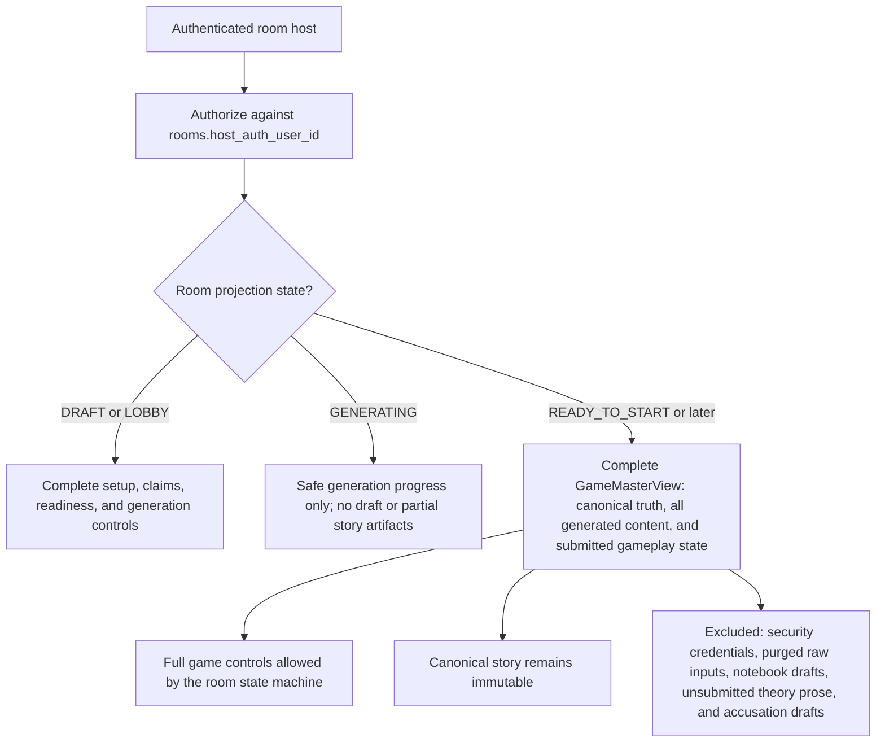

### 5.4 Persist, then notify

Every command commits database changes before any Realtime notification is sent. Realtime is an invalidation signal, not the source of truth.

### 5.5 Deterministic rules over AI judgment

Authorization, state transitions, evidence eligibility, scoring, faction victory, duplicate prevention, and story locking are deterministic application/database rules. The LLM produces content and recommendations only.

## 6. System Context

### 6.1 Overall architecture flowchart

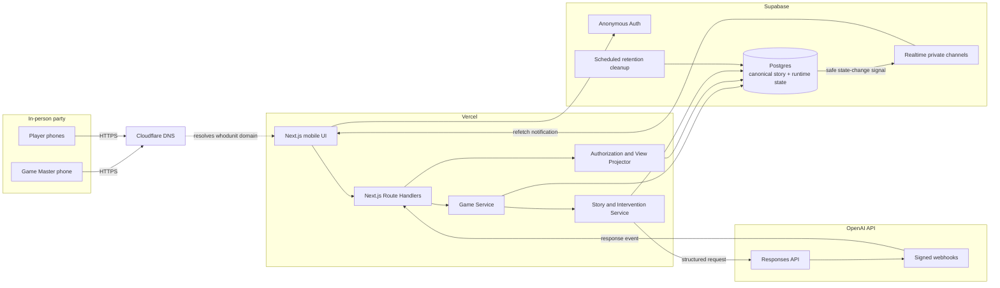

### 6.2 Component responsibilities

| Component | Responsibilities | Must not do |
|---|---|---|
| Next.js UI | Mobile screens, forms, optimistic loading, QR display, local session bootstrap | Decide authorization or hide secrets only in the browser |
| Route Handlers | Validate requests, verify sessions, enforce rate limits, call domain services, return typed projections | Contain story-generation prompts inline or expose provider keys |
| Game Service | Room lifecycle, joins, missions, round progression, releases, theories, accusations, scoring | Call the LLM directly or rewrite canonical story |
| Story Service | Build prompts, call OpenAI, parse structured output, run validators, manage repair attempts | Persist an unvalidated story as canonical |
| Intervention Service | Build current room context, rank eligible facts, request a suggestion, validate, stage for approval | Release an intervention without host approval |
| View Projector | Return the exact fields the current actor may see, including the complete projection for the authorized Game Master after story lock | Serialize the complete story to any player before reveal or to any unauthorized actor |
| Supabase Auth | Create anonymous browser identities and issue sessions | Treat anonymous identity as room membership |
| Postgres | Source of truth, transactions, constraints, RLS, append-only events, retention | Trust a room code as authorization |
| Realtime | Notify authorized room members that state changed | Carry private story payloads |
| OpenAI | Generate structured story content and bounded contextual suggestions | Store authoritative game state or invoke game mutations |

## 7. Deployment Topology

### 7.1 Production topology flowchart

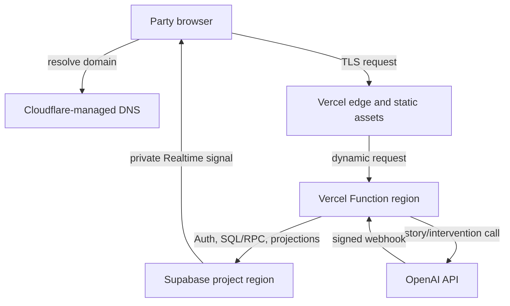

The Vercel Function region should be configured as close as practical to the Supabase database region, and both should be selected near the actual location of the first parties. Static assets remain globally cached. Player nationality must not be used as a proxy for physical deployment geography; compute and database placement should be revisited together when the party geography changes.

### 7.2 Environments

Use separate projects and credentials for:

- Local development.
- Preview/staging.
- Production.

Production data must never be copied into preview. Every environment has a distinct Supabase project, OpenAI project/API key, webhook secret, recovery-token pepper, and model budget.

### 7.3 Server-side secrets

The following values exist only in Vercel server environment variables:

- OPENAI_API_KEY
- OPENAI_WEBHOOK_SECRET
- SUPABASE_SERVICE_ROLE_KEY
- HOST_RECOVERY_TOKEN_PEPPER
- STORY_MODEL
- STORY_ESCALATION_MODEL
- INTERVENTION_MODEL

Only the Supabase project URL and publishable client key may be included in browser code. The service-role key and OpenAI key must never be exposed to the browser.

## 8. Room and Game Lifecycle

### 8.1 Room state machine

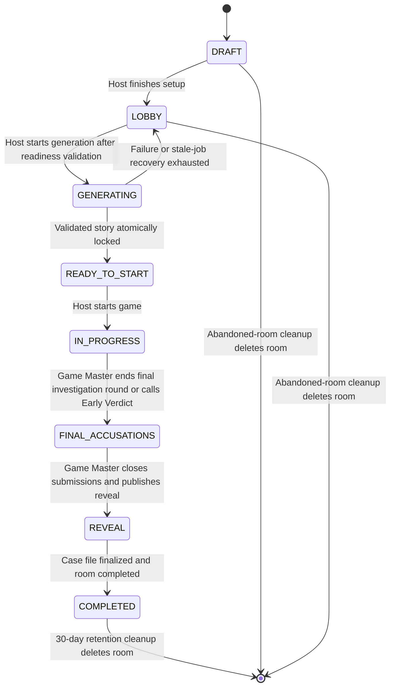

Allowed transitions are encoded in one shared state-machine module and enforced again in database command functions. A UI button is never the only transition guard.

### 8.2 Important lifecycle rules

- A room can have at most one active story-generation job.
- GENERATING does not mean a canonical story exists.
- The story becomes canonical only when the final validated package is committed in the same transaction that sets READY_TO_START and locked_at.
- READY_TO_START and later states can never transition back to GENERATING.
- A current or former host principal can never hold a pending, active, revoked, or reconnecting player membership in the same room.
- An early verdict changes progression, not the solution.
- No accusation eliminates a player or changes their access.
- Expiration is implemented by the audited deletion procedure rather than a durable EXPIRED room state.

### 8.3 Configuration validation

Before a room can leave LOBBY:

- Player count is between 4 and 12.
- Duration is one of 30, 45, 60, 90, or 120 minutes.
- Murderer, accomplice, and innocent counts are non-negative and sum to the player count.
- At least one murderer and one innocent are configured.
- Every player slot has a unique ID and a non-empty display name and costume.
- The current `host_auth_user_id` matches the open `room_host_principals` row, and no current or former host principal has a player claim or membership in this room.
- Every required player claim and description submission is complete.
- Every player has acknowledged the fictional-use and sensitive-input guidance, and the host has acknowledged the host guidance and confirmed room consent.

The Game Service returns balanced faction-count suggestions based on party size, but the host remains responsible for choosing a valid distribution. Duration selects a versioned round profile and target pacing; timers are informational and never advance the game automatically.

The initial reviewed profiles are `duration-v1` and `factions-v1`:

| Target duration | Investigation rounds | Round targets | Evidence events | Intervention cap per round |
|---:|---:|---|---:|---:|
| 30 minutes | 2 | 9, 9 min | 4–6 | 1 |
| 45 minutes | 3 | 9, 9, 9 min | 6–8 | 1 |
| 60 minutes | 3 | 12, 12, 12 min | 7–10 | 2 |
| 90 minutes | 4 | 15 min each | 10–14 | 2 |
| 120 minutes | 5 | 17 min each | 13–18 | 2 |

Each investigation round schedules one achievable mission per player. The remaining target time is allocated to the opening, final accusations, and reveal. These targets guide generated pacing but never trigger a state transition.

| Players | Murderers | Accomplices | Innocents |
|---:|---:|---:|---:|
| 4 | 1 | 0 | 3 |
| 5 | 1 | 1 | 3 |
| 6 | 1 | 1 | 4 |
| 7 | 2 | 0 | 5 |
| 8 | 2 | 1 | 5 |
| 9 | 2 | 1 | 6 |
| 10 | 2 | 2 | 6 |
| 11 | 3 | 1 | 7 |
| 12 | 3 | 2 | 7 |

These faction distributions are defaults, not forced choices. Every custom distribution still has to sum to the player count and contain at least one murderer and one innocent.

## 9. Identity, Joining, and Authorization

### 9.1 Identity model

Supabase anonymous sign-in creates a unique authenticated user without collecting email or password. This is a device session, not a room membership.

Four concepts remain separate:

1. **Anonymous auth user:** proves continuity of a browser session.
2. **Host authority:** `rooms.host_auth_user_id` identifies the one current host principal for the room.
3. **Player membership:** proves that an auth user is approved to control one player slot in the room.
4. **Player identity:** identifies which preconfigured character/player slot the member controls.

Host authority and player membership are mutually exclusive within a room. A current or former host principal cannot request, hold, reconnect, or be approved for a player membership. Current host authority is addressed through `rooms.host_auth_user_id`, all host principals are recorded in `room_host_principals`, and player authority exists only through `room_memberships`. Command functions and a cross-table database trigger reject any attempt to combine them, including a direct API or RPC call.

The host is never represented as a player in the StoryPackage, faction assignments, dossiers, missions, theories, accusations, or scoring. Immediately after story lock, the authenticated host receives the complete Game Master projection, including the canonical solution and all generated game content.

The host creates player slots before anyone joins. Each slot has an opaque player UUID, display name, costume, and optional background. The display name is presentation data and is never an authorization key.

### 9.2 Room codes

- Use a six-character, case-insensitive Crockford Base32-style code with ambiguous characters removed.
- Generate cryptographically random codes and enforce a unique database constraint.
- Resolve a code to an internal room UUID on the server.
- Do not use room codes in foreign keys.
- Do not put room UUIDs or codes into LLM safety identifiers without hashing.
- Rate-limit code lookup and return the same response shape for invalid and unavailable rooms.
- Knowledge of a code permits only safe lobby discovery, never private story access.
- The safe lobby discloses that the host is a dedicated non-playing Game Master with complete generated-game visibility after lock and access to submitted gameplay state; it separately identifies notebook drafts, unsubmitted theory prose, and final-accusation drafts as owner-only.

### 9.3 Player claim approval

The requirements allow a joining player to select their name. To stop someone with the room code from claiming another player's private dossier, the claim has a host-approval step.

The join and claim endpoints reject a guest session whose auth user appears in the room's host-principal history. Claim creation, claim approval, reconnect approval, and host recovery all acquire the same room row with `SELECT ... FOR UPDATE` before checking host history or membership and use the lock order room → player slot → membership. This serialization prevents a claim and recovery from both passing their exclusion checks concurrently. The approval transaction rechecks the invariant under lock so a current or former host cannot become a player through a stale request or direct RPC call.

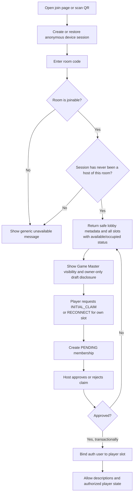

Claim approval is atomic. It verifies again that the claimant has never held Game Master authority for the room. A player slot has at most one active owner. If two devices request the same player, only the host-approved request can bind it; any second approval fails with a conflict.

### 9.4 Persisted name-to-device mapping

The authoritative mapping does not live in the displayed name or in browser-only state. It is the active room_memberships row joining a Supabase auth user to a player UUID.

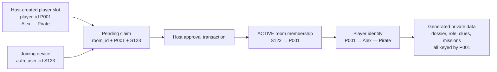

For example:

| Record | Value |
|---|---|
| Room | Internal UUID for room code H4W7N9 |
| Guest session | auth_user_id S123 |
| Player slot | player_id P001, Alex, Pirate |
| Membership | S123 is the ACTIVE player member for P001 in this room |
| Generated content | Every Alex dossier, mission, clue, note, and theory references P001 |

Names are not required to be globally unique. If two players have the same display name, their player UUIDs remain distinct and the join UI uses name plus costume to help the person select the correct slot.

Identity and role remain separate across the generation boundary:

- The player slot and membership exist before story generation.
- The faction and fictional role do not exist until a validated story is locked.
- Generated dossiers, roles, evidence, and missions reference player_id.
- Moving a player to a new device changes the membership, not player_id or generated content.

### 9.5 Reconnection

- Store the Supabase anonymous session in secure application-managed cookies.
- On refresh, verify the auth session and look up active memberships.
- Rebuild the authorized view from the database.
- Subscribe to the room's private Realtime channel after the initial view loads.
- Refetch whenever the tab regains focus, the network reconnects, or the received state version is newer.
- If browser storage is erased, the new device creates a RECONNECT pending claim for the occupied player slot.

Approving a reconnect is one transaction:

1. Lock the player slot and its active membership.
2. Verify the requesting guest session has never held Game Master authority for the room and is not already bound to another player in the room.
3. Revoke the old ACTIVE membership.
4. Promote the replacement membership to ACTIVE.
5. Append PLAYER_SESSION_REBOUND.
6. Increment the room state version and commit.

All progress remains attached to player_id, so dossiers, clues, missions, notes, theories, and accusations survive the rebind. The old device loses access on its next backend request because membership is checked for every projection and command.

All authenticated room pages and actor-specific Route Handlers use dynamic rendering and disable shared response caching. No rendered player or host payload may be reused across anonymous users.

### 9.6 Presence and disconnected status

Presence is best-effort UI state and is never used as authorization. An ACTIVE player membership remains active during an ordinary network interruption.

- Every authenticated room screen for an ACTIVE player membership sends a rate-limited heartbeat at most once every 30 seconds, including the waiting room and active gameplay screens. Claim and reconnect approval initialize `last_seen_at`.
- The backend records `last_seen_at` on the active player membership.
- The host projection derives **connected** when the heartbeat is recent and **disconnected** when it is older than the configured presence threshold, initially 90 seconds.
- Unclaimed, pending, connected, and disconnected are presentation states derived from player slots, claims, active memberships, and presence; they are not additional membership status values.
- A heartbeat contains no story or role data and never grants access.

### 9.7 Host recovery

Room creation returns a separate high-entropy recovery link. The secret:

- Is unrelated to the public room code.
- Is delivered in the URL fragment where possible, then exchanged via POST.
- Is stored only as an HMAC/hash in Postgres.
- Is never logged.
- Is rotated after successful recovery.
- Can be revoked from an active host session.

The recovery flow is one transaction: verify and consume the recovery secret; lock the room using the shared room-first lock order; reject recovery if the new auth principal has any player membership or claim in the room or appears in `room_host_principals`; close the previous host-tenure row; insert a new open tenure; replace `host_auth_user_id`; rotate the recovery secret; append HOST_RECOVERED; and commit. Recovery therefore requires a clean anonymous principal that has never been a player or Game Master in that room. It transfers only Game Master authority and never creates, revokes, or transfers a player membership. The previous session immediately loses host authority and remains permanently ineligible to claim a player slot in that room. The recovery exchange itself returns no story data; the next authorized fetch returns setup controls before lock or the complete Game Master projection after lock.

### 9.8 Authorization matrix

| Data/action | Visitor | Pending player | Confirmed player | Game Master |
|---|---:|---:|---:|---:|
| Safe lobby metadata | Yes | Yes | Yes | Yes |
| Public released events | No | No | Yes | Yes |
| Generated dossiers, roles, and missions | No | No | Own only | All after story lock |
| Notebook drafts, unsubmitted theory prose, and final-accusation drafts | No | No | Own only | No |
| Another player's private generated story data | No | No | No | Yes after story lock |
| Submitted private theories | No | No | Own only | Yes |
| Submitted final accusations | No | No | Own only | Yes |
| Canonical solution and prepared ending | No | No | Reveal only | Yes after story lock |
| Approve, revoke, or replace player claims | No | No | No | Yes in valid room states |
| Start game or advance rounds | No | No | No | Yes in valid room states |
| Generate story | No | No | No | Yes before lock |
| Preview/approve intervention | No | No | No | Full canonical preview |
| Close submissions and publish reveal | No | No | No | Yes in valid room states |

The Game Master receives all generated story content and submitted gameplay state after story lock and retains every host control allowed by the room state machine. The projection does not expose raw friend descriptions, description authorship, authentication or recovery secrets, player notebook drafts, unsubmitted theory prose, or final-accusation drafts.

## 10. Data Architecture

### 10.1 Schema boundaries

Use two Postgres schemas:

- **app_private:** canonical story, solution, raw descriptions, generation artifacts, recovery tokens, and internal command data. It is not exposed through the Supabase Data API.
- **public:** narrowly scoped RPC functions and safe Realtime signal rows. Grants are revoked by default and added explicitly.

All user-facing writes go through database command functions called with the user's authenticated JWT. Those functions use auth.uid(), verify either the active player membership or authoritative room host principal required by the action, and perform the full mutation transactionally.

Ordinary Game Master reads do not use the service-role key. A narrowly granted `SECURITY DEFINER` RPC, `get_game_master_view(room_id)`, uses a fixed `search_path`, verifies `auth.uid() = rooms.host_auth_user_id`, checks room state and `locked_at`, and then reads the required `app_private` rows. Before lock it returns only the setup/readiness projection; during GENERATING it returns safe progress; after lock it returns the complete typed `GameMasterView` in one database snapshot. Former hosts, players, visitors, and cross-room callers are denied. Player-facing projectors use separate membership-scoped functions and can never select the Game Master projection.

Service-role access is limited to:

- Story-generation completion.
- Verified OpenAI webhooks.
- Retention cleanup.
- Operational repair tooling.

### 10.2 Core entity relationship diagram

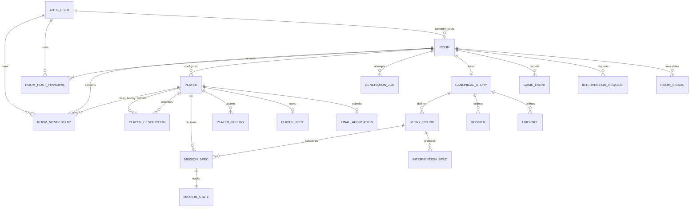

### 10.3 Table design

#### rooms

| Column | Notes |
|---|---|
| id | UUID primary key; all room-scoped tables reference it |
| room_code | Unique normalized human-readable code |
| host_auth_user_id | Authoritative current host principal; host commands compare this value with auth.uid(), while `room_host_principals` retains history |
| status | Room state enum |
| state_version | Monotonically increasing bigint |
| current_round_id | Nullable reference to generated round |
| config_json | Duration, faction counts, murderer awareness, locale |
| scoring_profile_version | Application-owned scoring rules selected before generation |
| story_id | Nullable until atomic lock |
| locked_at | Null before lock; immutable after set |
| sensitive_input_purge_pending | Set by story lock and cleared only after post-lock sensitive-input purge |
| started_at/completed_at | Lifecycle timestamps |
| expires_at | completed_at + 30 days |
| created_at/updated_at | Audit timestamps |

#### room_memberships

| Column | Notes |
|---|---|
| id | UUID |
| room_id | Required room scope |
| auth_user_id | Supabase auth user |
| player_id | Required player slot; host authority is stored separately on rooms |
| status | PENDING, ACTIVE, REVOKED |
| request_kind | INITIAL_CLAIM or RECONNECT |
| replaces_membership_id | Set by a reconnect request |
| approved_by | Host auth user |
| last_seen_at | Best-effort player-presence heartbeat; never used for authorization |
| joined_at/revoked_at | Audit timestamps |

Constraints prevent two ACTIVE memberships from claiming one player and prevent one auth user from actively claiming multiple players in the same room. Multiple pending requests and historical revoked memberships may exist, but approving one invalidates conflicting requests. A host principal never has a `room_memberships` row for that room. Host authority exists only through `rooms.host_auth_user_id`, and player authority exists only through `room_memberships`; claim and recovery commands plus a cross-table trigger enforce mutual exclusion.

#### room_host_principals

This tenure history records every auth principal that has ever held Game Master authority for a room. Rows are immutable except that `ended_at` may transition from null to a timestamp exactly once when authority transfers:

| Column | Notes |
|---|---|
| id | UUID |
| room_id | Required room scope |
| auth_user_id | Current or former Game Master principal |
| started_at | When authority began |
| ended_at | Null only for the current principal |

The pair `(room_id, auth_user_id)` is unique, so a former principal cannot regain Game Master authority in the same room. A unique partial index on `room_id WHERE ended_at IS NULL` permits at most one open tenure. Room creation inserts the room and its first open tenure in one transaction. A deferred constraint trigger enforces exactly one open tenure at commit and verifies that its `auth_user_id` equals `rooms.host_auth_user_id`. Claim and reconnect commands reject any auth user present in this table, so a former Game Master can never re-enter the same room as a player after recovery.

#### scoring_profiles

Application-owned immutable scoring configuration:

- unique semantic version.
- faction victory rules.
- point weights and bonus rules.
- canonical JSON checksum.
- created_at and retired_at metadata.

Profiles are installed through reviewed application/database migrations and cannot be edited after a room references them. The backend selects the room's profile before generation, injects its exact version into the canonical package envelope after model output, and includes it in the package checksum. The LLM cannot choose or modify the profile.

#### duration_profiles and faction_recommendation_profiles

Application-owned pacing and recommendation configuration is installed by reviewed migrations. Each row has a semantic version, canonical JSON payload, SHA-256 checksum, and normalized lookup fields. Duration profiles define the investigation-round count and targets, mission density, evidence-event range, and intervention cap. Recommendation profiles define the balanced default for each supported 4–12 player count.

Rooms reference both the duration-profile version and selected duration through a restrictive foreign key. Profile rows reject update and delete, so future versions can be added without changing the pacing or recommendation presented to an existing room.

#### players

Contains only host-entered player setup:

- id and room_id.
- display name and normalized comparison form.
- costume.
- optional host-provided background.
- seat/order value.
- onboarding state.

The player table does not contain a session ID or claimed_by field; that mapping belongs to room_memberships so it can be revoked and replaced without changing player identity. Faction, role, secrets, and alibi also do not live in this table.

#### player_descriptions

Contains:

- room_id.
- author_player_id.
- subject_player_id.
- description text.
- submitted_at.
- purged_at.

There is one row per author/subject pair, authors cannot describe themselves, and authorship is never included in model output or player views. Raw descriptions are treated as untrusted personal input.

#### story_generation_jobs

Tracks:

- Job state and phase.
- Idempotency key.
- Attempt and repair counts.
- Model and prompt versions.
- Story-schema version.
- OpenAI response IDs.
- Token usage and latency.
- Sanitized error code.
- Created, started, and finished timestamps.

Only one non-terminal job may exist per room.

#### canonical_stories

Contains:

- One row per room.
- Story schema version.
- Complete validated structured package in JSONB.
- SHA-256 checksum of canonicalized JSON.
- Solution checksum.
- Prompt/model metadata.
- locked_at.

A database trigger rejects update and delete after room lock, except deletion through the retention procedure. A unique room_id constraint prevents a second story.

#### Materialized story tables

The canonical JSON is the audit artifact. Server projections and game rules use materialized rows created in the same lock transaction:

- story_rounds
- dossiers
- relationships
- timeline_events
- evidence
- evidence_dependencies
- mission_specs
- consequence_specs
- intervention_specs
- accomplice_revelations
- final_reveal_sections

Scoring is application-owned configuration rather than generated story content. Each room stores a `scoring_profile_version` selected before generation; the canonical package references that version but the LLM never authors point weights or victory rules.

These rows carry stable generated IDs and remain immutable after lock.

#### Runtime tables

| Table | Purpose |
|---|---|
| mission_states | Accepted, requested, completed, failed, waived, and consequence status |
| evidence_releases | Records one-time public or private clue releases |
| intervention_requests | Context snapshot version, model job, suggestion, approval, and release status |
| player_notes | One owner-only notebook per player: notes text, suspect IDs, revision, and timestamps |
| player_theories | Submitted structured theory snapshot, supporting evidence selections, optional submitted explanation, timestamp, and score; readable by its owner and the Game Master |
| final_accusations | Owner-only DRAFT or Game Master-visible SUBMITTED structured final case per player |
| game_events | Append-only ordered history of every meaningful transition |
| command_receipts | Idempotency keys and prior command results |
| webhook_receipts | Deduplicates provider webhook IDs |
| room_signals | Safe state version used by Realtime |
| host_recovery_tokens | Token hash, expiry, rotation, and revocation |

`player_notes` is keyed by `(room_id, player_id)`, not by auth user, so an approved device replacement preserves it. Notebook writes use optimistic row revisions to prevent an older autosave from silently overwriting a newer edit. Notebook prose is never included in story generation, live-intervention context, or the host's case file.

`final_accusations` is keyed by `(room_id, player_id)` and has an explicit `DRAFT` or `SUBMITTED` status plus a revision. Drafts are visible only to their owning player. Submission is a transactional state change that fixes `submitted_at`, makes the snapshot immutable, and exposes it to the Game Master. Closing submissions prevents any new submission. Only submitted snapshots are scored or included in the case file.

### 10.4 Append-only event log

Every meaningful runtime change appends a game_events row with:

- room_id.
- strictly increasing room sequence.
- event type.
- actor type and actor ID where appropriate.
- source object ID.
- public-safe metadata.
- private payload in app_private when needed.
- command/idempotency ID.
- occurred_at.

Examples include ROOM_STARTED, ROUND_ADVANCED, MISSION_COMPLETION_REQUESTED, MISSION_COMPLETED, MISSION_FAILED, CONSEQUENCE_RELEASED, EVIDENCE_RELEASED, INTERVENTION_APPROVED, EARLY_VERDICT_CALLED, ACCUSATION_SUBMITTED, and REVEAL_PUBLISHED.

The event log is not event sourcing for all state. Current state remains materialized for simple reads. The log provides auditability, final case-file reconstruction, and LLM gameplay context.

## 11. Story Package Contract

### 11.1 Top-level contract

The TypeScript StoryPackage is defined with Zod and converted to the JSON Schema supplied to Structured Outputs. It contains:

- metadata
- victim
- canonicalSolution
- factions
- characters
- relationships
- timeline
- evidenceGraph
- rounds
- dossiers
- missions
- consequences
- preGeneratedInterventions
- accompliceRevelations
- scoringProfileVersion
- finalReveal
- fullCaseNarrative

Every object has a stable, opaque ID. References use IDs, not names, so duplicate or Unicode names do not break relationships.

### 11.2 Canonical solution

The solution includes:

- NPC victim identity and fictional backstory.
- Murderer player IDs.
- Accomplice player IDs.
- Motive facts.
- Method facts.
- Ordered crime timeline.
- Required supporting evidence IDs.
- Explanation of every intentional red herring.

The solution is available only to server-side game logic and the authorized Game Master after story lock. It is withheld from every player until reveal.

### 11.3 Character dossier

Each dossier includes:

- Public character name and costume-aware identity.
- Private background.
- Canonical faction stored server-side plus a player-visible knowledge policy.
- Player-visible role instructions appropriate to the current reveal state.
- Fictional secrets.
- Motives and suspicious behavior.
- Alibi statements by round.
- Known facts at game start.
- Delayed knowledge and its release rule.
- Constraints for murderer-awareness mode.

In murderer-unaware mode, the pre-reveal player projection omits the true murderer faction, murderer objectives, and murderer-specific wording. The canonical faction remains available to server-side validation and scoring and to the Game Master after story lock. Missions for an unaware murderer must remain plausible without disclosing that hidden identity.

Raw friend descriptions and their authors never appear in a dossier.

### 11.4 Mission contract

Missions use typed, achievable actions rather than free-form success criteria. Example action kinds:

- ASK_PLAYER
- SHARE_FACT
- MAKE_PUBLIC_CLAIM
- PRESENT_EVIDENCE
- SUBMIT_PRIVATE_THEORY
- COMPARE_ALIBIS
- REQUEST_INFORMATION

Each mission has:

- Assigned player ID.
- Round ID.
- Player-visible objective.
- Typed completion rule.
- Target IDs if applicable.
- Player-visible stakes.
- Host-visible confirmation guidance.
- Optional success release.
- Optional failure consequence ID.

The completion rule must depend only on an action the assigned player can perform. Outcomes such as “convince another player” or “make someone confess” are invalid.

### 11.5 Evidence graph

Evidence is a directed graph:

- Nodes are facts, clues, testimony, and conclusions.
- Edges express supports, contradicts, requires, or red-herring-explained-by.
- Release rules specify round, audience, prerequisites, and fallback availability.
- At least one guaranteed evidence path supports each required solution element.

No critical solution fact may depend solely on a mission that can fail or an intervention that may never be requested.

## 12. Story Generation Pipeline

### 12.1 Generation flowchart

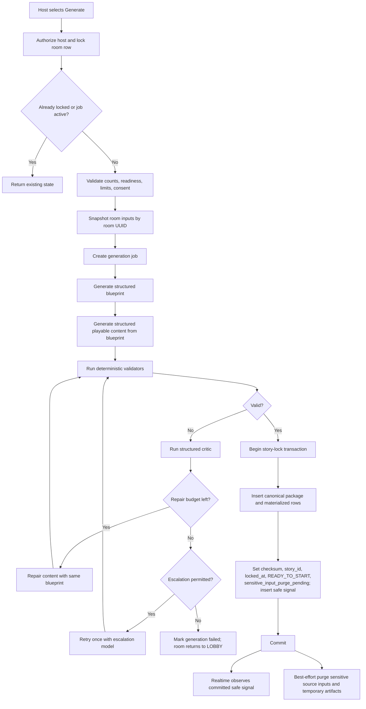

### 12.2 Input snapshot

Generation input includes:

- Room configuration.
- Player IDs, display names, costumes, and optional per-player details entered by the host.
- Private friend descriptions without author identities.
- Duration and faction distribution.
- Murderer awareness setting.
- Application-owned scoring profile version.
- Content and cultural-sensitivity instructions.
- Story, prompt, and validator versions.

Descriptions are delimited as untrusted data. Instructions embedded in a player's text are never treated as system or developer instructions.

### 12.3 Multi-stage generation

The MVP uses explicit artifacts rather than relying on implicit conversation memory:

1. **Blueprint:** solution, role assignment, relationships, crime timeline, evidence graph, and round outline.
2. **Playable content:** dossiers, missions, consequences, interventions, delayed reveals, and final narrative, all anchored to blueprint IDs. The package references the room's application-owned scoring profile rather than generating scoring rules.
3. **Validation:** deterministic rules plus an LLM critic that returns only a structured issue list.
4. **Repair:** a bounded correction pass that preserves a valid blueprint. If the blueprint itself is invalid, the attempt restarts before lock.

Intermediate artifacts remain attached to the generation job and are never visible to clients.

### 12.4 Background execution

Story generation may take longer than a normal browser request. The backend:

1. Creates the generation job and returns HTTP 202.
2. Starts an OpenAI background Response for the current pipeline phase.
3. Stores the response ID.
4. Updates the waiting room through job status signals.
5. Accepts a signed response.completed webhook.
6. Deduplicates the webhook ID.
7. Records the receipt and acknowledges the webhook.
8. Uses Next.js after() to retrieve, parse, and validate the response after acknowledgement.
9. Starts the next background phase when required.
10. Reconciles stale jobs idempotently when the host polls generation status if a webhook or after() task is interrupted.

The after() work remains bound by the Vercel Function duration, so every pipeline phase is resumable from story_generation_jobs. The status endpoint can safely continue a phase from its last durable checkpoint; it never restarts a completed phase.

Provider storage is explicit:

- Story-generation background requests use store: false where supported. The provider may retain background response data temporarily to support asynchronous completion.
- Live intervention requests use store: false.
- Whodunit copies the validated application artifact into Supabase and does not use provider retention as storage.

### 12.5 Model policy

- Default story and repair model: gpt-6.1-sol.
- Optional escalation after exhausted normal repair: gpt-6-astra.
- The model IDs are environment configuration and recorded on each job.
- A model change requires running the story evaluation suite before production rollout.
- No automatic fallback may silently switch to an untested model.
- Per-room attempt and token budgets prevent runaway cost.

Suggested initial limits:

- One active generation job per room.
- Two repair passes with the default model.
- One full escalation attempt.
- No user-triggered regeneration after lock.

### 12.6 Atomic story lock

The lock transaction:

1. Acquires a row lock on rooms.
2. Verifies status is GENERATING and locked_at is null.
3. Verifies generation job ownership and terminal success.
4. Inserts the canonical story and all materialized story rows.
5. Computes/stores checksums.
6. Sets story_id, locked_at, and READY_TO_START.
7. Appends STORY_LOCKED.
8. Increments state_version.
9. Commits once.

Any failure rolls the entire transaction back. A partial story is never playable or readable through `GameMasterView`. Before commit, the Game Master sees only generation status. After commit, one snapshot exposes every locked StoryPackage section and its materialized rows together; there is no state where the solution is visible but dossiers, missions, releases, or the prepared ending are missing.

The lock transaction also sets the durable `sensitive_input_purge_pending` marker and inserts the safe state-change signal. After commit, client notification and sensitive-input cleanup proceed independently. Cleanup atomically purges raw friend descriptions, host-provided background notes, and temporary generation artifacts, then clears the marker. A scheduled sweeper retries any pending purge so a process interruption cannot retain those inputs indefinitely or delay story readiness.

## 13. Story Validation

Structured Outputs guarantees schema shape, not narrative truth. The following validations are required before lock.

### 13.1 Structural validation

- All IDs are unique.
- Every reference resolves inside the same room package.
- The set of generated character owner IDs, faction-assignment player IDs, and dossier player IDs each equals the exact configured `players.id` set—no missing, duplicate, fabricated, or extra player IDs.
- Exactly one generated character, faction assignment, and dossier exists for every configured player. Every generated mission owner references that set, and required per-round missions cover every active player. Runtime theory, accusation, and score rows are separately constrained by room-scoped foreign keys to configured players.
- Faction counts equal player count.
- Murderer and accomplice counts match configuration.
- Exactly one NPC victim exists.
- No player is marked as eliminated.
- Round count and target timing match the selected duration profile.
- Every investigation round has a public event and at least one mission per active player.
- Every consequence and evidence release has a valid eligibility rule.

### 13.2 Information-flow validation

- No public event reveals the solution before the reveal.
- A player's dossier includes only knowledge available to that player at that point.
- Each accomplice's projection omits murderer player IDs until the scheduled private revelation. The accomplice may know their own faction from the beginning.
- Murderer-awareness mode is honored.
- The Game Master projection includes every StoryPackage section and materialized generated record after story lock, including characters, relationships, timeline, factions, dossiers, solution, rounds, missions, consequences, released and unreleased evidence specifications, intervention sources, accomplice revelations, the prepared ending, and the full case narrative.
- StoryPackage schemas accept only configured player IDs for player-owned records. Auth-user IDs, including every host principal, are a different identifier type and are never supplied as candidate player IDs to generation.
- Raw friend descriptions and author identities never appear in generated output.

### 13.3 Mission validation

- Each objective maps to a supported action kind.
- Completion depends only on the assigned player's action.
- Success criteria are observable by the host or recorded by the system.
- Stakes are visible before mission acceptance.
- Consequences expose only fictional in-game information.
- Severity does not decrease across designated escalation levels.

### 13.4 Solvability validation

- Each murderer has at least two independent evidence paths.
- Motive and method each have guaranteed discoverable support.
- Required facts survive every allowed combination of mission failures.
- The final mandatory round releases any still-hidden critical evidence.
- Red herrings have canonical explanations.
- No two timeline events create impossible location or time overlaps.
- Every alibi contradiction is intentional and explained.

### 13.5 Semantic critic

The critic receives the structured package and returns issue objects:

- severity
- category
- affected IDs
- explanation
- suggested repair constraint

It does not return a replacement story or make the lock decision. Critical and high issues block locking. Medium issues block until repaired or explicitly covered by an approved deterministic rule.

## 14. Context-Aware Live Interventions

### 14.1 Safety boundary

The live intervention system is context-aware but not canon-authoring.

It may:

- Select an unused eligible clue.
- Recommend a prepared consequence or emergency event.
- Select a prepared directed-question template and eligible players.
- Choose a presentation style or urgency for canonical text.
- Target an underused interaction based on mission/event state.
- Increase urgency or theatrical tone.

It may not:

- Create a new clue or relationship.
- Change the motive, method, timeline, role, or alibi.
- Reveal notebook or unsubmitted theory prose to any other actor, or expose a submitted theory to another player.
- Provide an automatic correctness signal to any player. The Game Master already has authorized canonical access, but the intervention model does not judge suspicions for any audience.
- Release content before its eligibility rule.
- Write directly to any game table.

### 14.2 Intervention context

The backend creates a fresh, room-scoped snapshot for every request:

- Story checksum and schema version.
- Current round and room state version.
- Publicly released event IDs.
- Eligible unused intervention/evidence IDs.
- Mission outcome summaries.
- Previously used intervention levels.
- Aggregate suspicion patterns without correctness feedback or author attribution.
- Permitted target player IDs.
- Explicit forbidden facts and IDs.

Raw friend descriptions are excluded. Private theory prose is excluded; only bounded aggregates may be used.

Intervention levels escalate within a round. The first accepted request prefers a gentle nudge, the next prefers eligible new evidence, and the final permitted request prefers an emergency event. The host may reject a suggestion without consuming the level, subject to rate and retry limits. No round may exceed its generated intervention limits.

### 14.3 Intervention flowchart

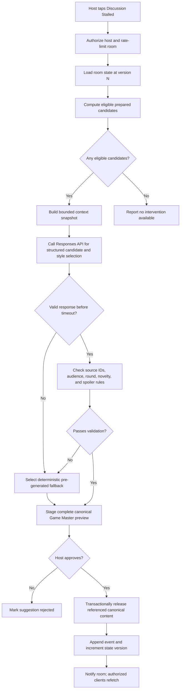

### 14.4 Structured intervention output

The model returns:

- interventionLevel
- candidateKind and interventionSpecId, evidenceId, or missionSpecId
- audience type
- optional targetPlayerId
- presentationStyle from an application-defined enum
- non-spoiler reason code

The application loads the canonical object referenced by the ID and validates its typed effect, eligibility, audience, and target. Fact-bearing text is rendered from the stored canonical object and application-owned templates; model text is never displayed directly. Typed effects may release canonical evidence, stage a prepared question, or activate a pre-generated urgent mission, but they cannot create new facts or arbitrary state mutations.

The Game Master previews the complete intervention, its canonical source content, and its typed effect before approval. General validation still enforces source IDs, audience, release eligibility, target validity, and player spoiler boundaries.

### 14.5 Fallback behavior

Live AI has a strict party-friendly latency budget. If it times out, refuses, returns invalid data, or exceeds a room budget:

- Select the next unused pre-generated intervention deterministically.
- Tell the host that a prepared intervention is ready; do not expose an infrastructure error to players.
- Record the provider failure for operations.
- Keep the game progressing.

The LLM is therefore an enhancement to intervention selection, not a single point of failure.

## 15. Gameplay Command Processing

### 15.1 Generic host domain-command flow

This flow applies to host-authorized domain commands that change shared game state, such as advancing a round, deciding a mission, releasing evidence, approving an intervention, or publishing the reveal.

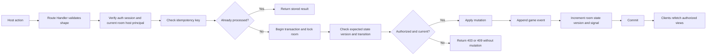

Every command covered by this flow includes:

- A UUID idempotency key.
- The client's expected room state version.
- The target object ID.

A duplicate returns its original command result. A stale version returns HTTP 409 and the client refetches before offering the action again.

The Route Handler's initial host check is only an early rejection. Every host command transaction acquires the room row first and then rechecks `auth.uid() = rooms.host_auth_user_id` before any mutation. If recovery commits first, an old-host command waiting on the lock fails authorization without changing state; if the command commits first, recovery proceeds afterward from the new state version.

Room creation and idempotent setup PUT/PATCH operations have endpoint-specific concurrency rules. Presence heartbeats use a rate-limited upsert, while notebook autosaves use the notebook row revision; neither takes the room lock or increments gameplay state version.

### 15.2 Round advancement

Advancing a round:

1. Locks the room.
2. Confirms the current host principal and current round.
3. Classifies unfinished missions according to host choices: failed, waived, or deadline extended.
4. Creates eligible pending consequences but does not automatically expose them unless configured.
5. Releases guaranteed next-round public content.
6. Activates next-round private missions.
7. Privately releases murderer identities to each accomplice when their audience-scoped revelation is scheduled.
8. Appends ordered events.
9. Increments state_version.
10. Commits and signals.

The next round can always advance even when no mission succeeds.

### 15.3 Mission lifecycle

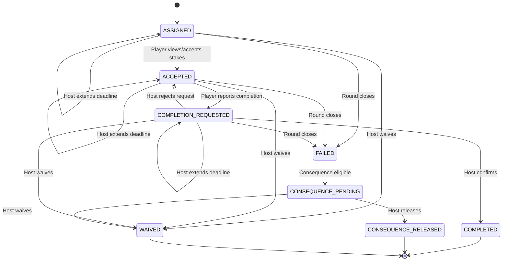

Mission specs are immutable; mission_states record progress.

## 16. Realtime Synchronization

### 16.1 Invalidation, not payload delivery

Realtime messages contain only:

- room_id.
- new state_version.
- broad change type such as ROUND_CHANGED or PLAYER_STATE_CHANGED.

They do not contain roles, evidence text, mission content, theories, or the solution.

### 16.2 Synchronization flowchart

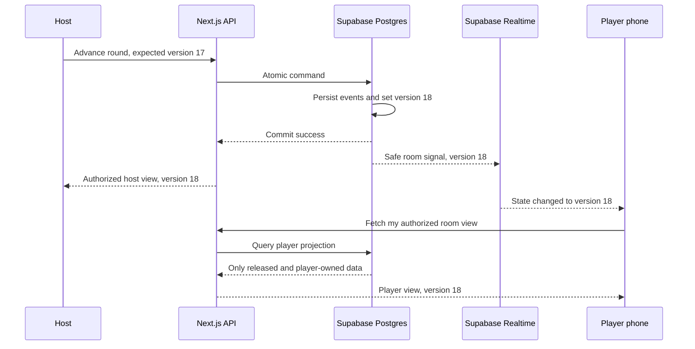

### 16.3 Missed signals

Clients always refetch:

- After subscription establishment.
- When returning to the foreground.
- After reconnecting network.
- When a command returns 409.
- On a slow safety poll while a game is active.

If Realtime is unavailable, polling preserves correctness. Realtime only improves latency.

### 16.4 Presence delivery

Presence heartbeats update `last_seen_at` without incrementing the gameplay `state_version` or appending a game event. The host dashboard refreshes the derived presence projection on a short poll and may also subscribe to a host-authorized, content-free presence signal. A missed presence signal can only make the indicator temporarily stale; it cannot expose data or change access.

## 17. API Surface

Next.js App Router Route Handlers expose a versioned JSON API. Representative endpoints:

### 17.1 Room and onboarding

| Method | Endpoint | Purpose |
|---|---|---|
| POST | /api/v1/rooms | Create room and host recovery secret |
| POST | /api/v1/rooms/{roomId}/recover | Exchange and rotate host recovery secret |
| GET | /api/v1/rooms/lookup?code=... | Return safe join metadata |
| PATCH | /api/v1/rooms/{roomId}/setup | Edit setup before generation |
| POST | /api/v1/rooms/{roomId}/claims | Player-only request for identity using kind INITIAL_CLAIM or RECONNECT; current or historical room host principals are ineligible |
| POST | /api/v1/rooms/{roomId}/claims/{claimId}/approve | Host approves claim |
| DELETE | /api/v1/rooms/{roomId}/claims/{claimId} | Host rejects a pending claim |
| POST | /api/v1/rooms/{roomId}/memberships/{membershipId}/revoke | Host revokes an active player binding |
| PUT | /api/v1/rooms/{roomId}/descriptions/{subjectId} | Submit private description |
| POST | /api/v1/rooms/{roomId}/presence | Rate-limited heartbeat for the active player membership |
| GET | /api/v1/rooms/{roomId}/state | Return actor-specific projection |

### 17.2 Generation

| Method | Endpoint | Purpose |
|---|---|---|
| POST | /api/v1/rooms/{roomId}/generation | Start idempotent generation |
| GET | /api/v1/rooms/{roomId}/generation | Read safe generation status |
| POST | /api/v1/webhooks/openai | Receive verified provider events |

### 17.3 Gameplay

| Method | Endpoint | Purpose |
|---|---|---|
| POST | /api/v1/rooms/{roomId}/start | Start locked game |
| POST | /api/v1/rooms/{roomId}/rounds/advance | Advance current round |
| POST | /api/v1/missions/{missionId}/completion-request | Player requests completion |
| POST | /api/v1/missions/{missionId}/decision | Host completes, rejects completion, fails, waives, or extends deadline |
| POST | /api/v1/consequences/{consequenceId}/release | Host releases consequence |
| POST | /api/v1/rooms/{roomId}/interventions | Request context-aware suggestion |
| POST | /api/v1/interventions/{requestId}/approve | Approve and release |
| POST | /api/v1/interventions/{requestId}/reject | Reject suggestion |
| PUT | /api/v1/rooms/{roomId}/notebook | Save owner-only notebook with expected row revision |
| POST | /api/v1/rooms/{roomId}/theories | Submit a private theory snapshot for scoring and authorized Game Master review |
| POST | /api/v1/rooms/{roomId}/early-verdict | Enter final accusations |
| PUT | /api/v1/rooms/{roomId}/accusation/draft | Save owner-only final-case draft with expected revision |
| POST | /api/v1/rooms/{roomId}/accusation/submit | Submit current final-case snapshot and expose it to the Game Master |
| POST | /api/v1/rooms/{roomId}/reveal | Close final-case submissions and publish result |
| GET | /api/v1/rooms/{roomId}/case-file | Fetch authorized postgame case file |

### 17.4 Response rules

- Errors use stable machine codes and non-sensitive messages.
- No error reveals whether a guessed player, room UUID, role, or secret exists.
- Domain state-changing commands require idempotency keys. Presence heartbeats use a rate-limited upsert, and notebook saves use an expected row revision.
- Provider response IDs are never returned to clients.
- Actor-specific DTOs are separate TypeScript types rather than optional fields on one giant DTO.

### 17.5 Client routes and screens

| Route/screen | Primary projection | Notes |
|---|---|---|
| /create | Visitor | Create an anonymous host session and room |
| /host/{roomId}/setup | HostSetupView | Players, costumes, configuration, validation |
| /host/{roomId}/claims | GameMasterClaimsView | Approve or reject initial and reconnect claims; revoke or replace active bindings |
| /join | Visitor | Room-code entry |
| /room/{roomId}/claim | SafeLobbyView | Show Game Master visibility/privacy disclosure, select a name, and wait for host approval |
| /room/{roomId}/describe | PlayerOnboardingView | Private descriptions of other players |
| /room/{roomId}/waiting | LobbyView | Arrival and submission status only |
| /room/{roomId}/dossier | PlayerView | Private character dossier |
| /room/{roomId}/mission | PlayerView | Current objectives, criteria, and stakes |
| /room/{roomId}/evidence | PlayerView | Public plus actor-authorized private clues |
| /room/{roomId}/notebook | PlayerView | Private notes, suspects, and theories |
| /host/{roomId}/dashboard | GameMasterView | Setup controls before lock; complete generated mystery, submitted gameplay state, and full game controls after lock |
| /room/{roomId}/accuse | PlayerView | Structured final case submission |
| /room/{roomId}/reveal | RevealView | Shared solution and results |
| /host/{roomId}/case-file | PostgameHostView | Complete chronological case file |

Gameplay pages are mobile-first, use large touch targets, support screen readers, avoid meaning conveyed by color alone, and keep the current objective accessible without deep navigation. Connectivity state and last-synchronized state version remain visible during active play.

## 18. Final Accusations, Scoring, and Reveal

### 18.1 Accusation structure

Each final accusation stores:

- DRAFT or SUBMITTED status and optimistic revision.
- Suspected murderer IDs.
- Suspected accomplice IDs.
- Selected motive statement/fact IDs.
- Selected method statement/fact IDs.
- Supporting released evidence IDs.
- Optional free-text explanation.
- Nullable submission timestamp and room state version.

Only released evidence may be selected. Free text is displayed but does not decide correctness. DRAFT records are owner-only; SUBMITTED records are immutable and visible to the Game Master.

### 18.2 Scoring

Scoring is deterministic and versioned in application-owned `scoring_profiles`. The room records its profile version before story generation; the generated package only references that version. It must:

- Award partial credit per correctly identified murderer.
- Award a full-set bonus without making partial deductions worthless.
- Penalize unsupported random guesses less favorably than evidence-backed theories.
- Award optional accomplice, motive, method, and evidence bonuses.
- If enabled by the scoring profile, award an early-deduction bonus only when a theory was recorded in an earlier round and cited then-available evidence.
- Calculate faction victory exactly as defined in requirements.

The LLM never defines point weights, victory rules, or grades accusations.

The reviewed `score-v1` profile uses these deterministic weights:

| Scored item | Points |
|---|---:|
| Each correctly named murderer | +20 |
| Each incorrectly named murderer | -5 |
| Exact full murderer set | +20 |
| Each correctly named accomplice | +5 |
| Each incorrectly named accomplice | -2 |
| Correct motive | +10 |
| Correct method | +10 |
| Each correctly cited supporting evidence item | +3, capped at +15 |
| Qualified early deduction | +2 per remaining investigation round, capped at +10 |

Totals cannot fall below zero. A theory qualifies for the early bonus only when it names the complete murderer set and cites at least two then-released supporting evidence items. Only the earliest qualifying theory is used. `earlyBonus = min(10, 2 × (roundCount - submittedRoundSequence + 1))`.

A murderer is identified for the faction result when a strict majority of all configured innocent players name that murderer in submitted final cases. Every murderer must be identified for the innocents to win; otherwise murderers win and accomplices share their result. Non-submitters receive zero points and contribute no vote, but remain in the strict-majority denominator.

Scoreboard ties share the same rank. Version 1 issues three single-recipient fun awards using deterministic tie-breakers:

- **Master Detective:** highest final score; tie by earlier final submission, then seat order.
- **Earliest Breakthrough:** earliest qualifying theory; tie by submission time, then seat order.
- **Evidence Hound:** most correct supporting evidence; tie by total score, then seat order.

The Game Master may close once everyone submits. Early close requires a confirmation naming missing players and explaining their zero score/no-vote outcome. A disconnected player is treated the same as any other missing submitter. Closing with zero submissions requires a second explicit confirmation and produces a murderer/accomplice faction win with all scores zero.

Scoring-profile versions may change for future rooms without changing old rooms. The database stores the canonical profile JSON and checksum, and final scoring snapshots repeat that version and checksum.

### 18.3 Endgame flowchart

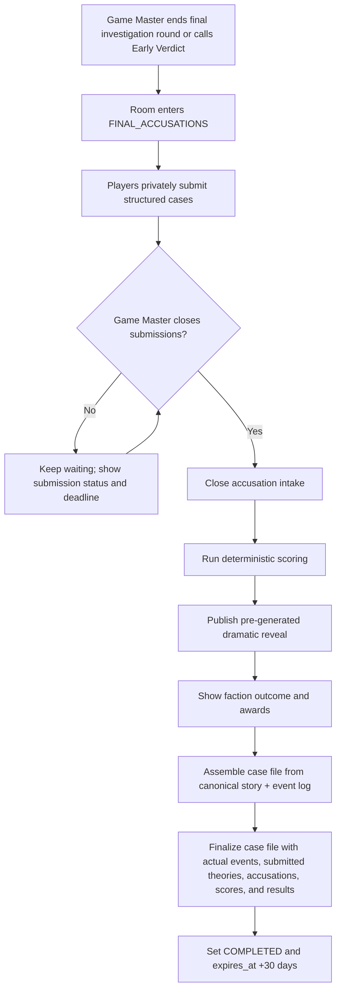

The final narrative may insert actual event outcomes into prepared slots, but it never asks the LLM to rewrite what happened.

The host case file contains every submitted theory snapshot—structured selections, cited evidence, optional submitted explanation, timestamp, and score—plus submitted final accusations and runtime outcomes. Raw descriptions and authorship, notebook drafts, suspect drafts, unsubmitted theory prose, and final-accusation drafts never enter it.

## 19. Security Design

### 19.1 Threat model and mitigations

| Threat | Mitigation |
|---|---|
| Guessing room codes | Rate limits, Turnstile on abusive paths, host approval, code is not authorization |
| Cross-room reads | UUID foreign keys, membership checks, RLS/RPC tests, room-scoped repository methods |
| Player impersonation | Host-approved claims, one active claim per slot, revocation flow |
| Host secret theft | High entropy, hashed storage, fragment exchange, rotation, no logs |
| Player obtains Game Master authority or host is bound to a player slot | Mutually exclusive host/player identities, recovery-secret verification, transactional claim and recovery checks, cross-table trigger, and database tests |
| Client tampering | All commands authorized and validated server/database side |
| Duplicate host actions | Idempotency receipts, row locks, unique release constraints |
| Prompt injection in descriptions | Treat as data, no tools, strict schema, deterministic validation |
| AI invents a fact during play | Candidate allowlist, canonical IDs, typed effects, server-rendered fact text, host approval |
| XSS through generated/user text | Render as text, never raw HTML; CSP and output escaping |
| CSRF | SameSite secure cookies, Origin checks, CSRF token for sensitive recovery/host commands |
| OpenAI webhook forgery/replay | Signature verification, timestamp checks, unique webhook ID |
| Service key exposure | Server-only modules and environment variables; secret scanning |
| LLM cost abuse | Game-Master-authorized calls, room budgets, per-round limits, rate limits, one active request |
| Realtime subscription leak | Content-free invalidation signals, private-channel authorization, short-lived JWT refresh, and fully re-authorized RPC reads |
| Stale authorization after revocation | Commands and state RPCs deny immediately; an existing channel may receive content-free invalidations until reauthorization or token expiry |

### 19.2 Database authorization

- Enable RLS on every exposed public table.
- Revoke default anon and authenticated grants before granting the minimum needed operations.
- Browser clients cannot write game tables directly.
- Public RPC functions use auth.uid() and fixed search_path values.
- SECURITY DEFINER functions are narrowly scoped and explicitly granted.
- Private Realtime channel authorization permits only an ACTIVE player membership for the room or `rooms.host_auth_user_id = auth.uid()` when the subscription is authorized. Recovery immediately excludes the prior host from every command and state RPC. An already-authorized channel may continue receiving content-free state-version invalidations until reconnect, JWT refresh, or token expiry; those signals contain no story data, and every attempted refetch is denied.
- Cross-room allow and deny cases are mandatory database tests.
- Canonical story tables live outside the exposed schema.

### 19.3 LLM security and safety

- No model call receives database credentials or callable game tools.
- Use a pseudonymous HMAC-derived safety identifier, not a player name.
- Set provider storage behavior deliberately; do not rely on defaults.
- Never log raw prompts, descriptions, model outputs containing private roles, or API keys.
- Strip control characters and enforce per-field length limits.
- Tell hosts and players not to enter real secrets, medical data, financial data, caste/religion claims, or allegations.
- Generated fiction must avoid using protected or sensitive real traits as a crime motive.
- Preserve Indian names and Unicode text without stereotyping, anglicizing, or inferring culture from a name.

## 20. Privacy and Retention

### 20.1 Data classes

| Class | Examples | Exposure |
|---|---|---|
| Public-safe | Room title, join status, display names, costumes | Join lobby |
| Player-personal | Notebook drafts, unsubmitted theory prose, and final-accusation drafts | Owning player only |
| Player-game-private | Player-visible dossier and role knowledge, missions, submitted theories, submitted final accusations | Owning player and Game Master; otherwise only an explicitly configured audience |
| Host-operational | Mission status, completion criteria, pending consequences | Game Master |
| Canonical-secret | Complete true faction map, solution, unreleased evidence, prepared ending | Server and Game Master after story lock; otherwise disclosed only by an explicit audience rule or the reveal |
| Sensitive input | Friend descriptions, host background notes | Generation service only |
| Operational | Job IDs, error codes, latency, token counts | Maintainers only |

### 20.2 Retention policy

- Raw friend descriptions and host-provided background notes are purged after successful story lock because regeneration is forbidden and the generated package is sufficient for gameplay. The durable `sensitive_input_purge_pending` sweeper guarantees retry after a post-lock interruption.
- Per-attempt snapshots, provider response artifacts, and invalid generated output are purged within 24 hours after a generation job becomes terminal. Source player descriptions remain while an unlocked room is still eligible for retry, then are removed on successful lock or room deletion.
- DRAFT and LOBBY rooms inactive for seven days are deleted after a day-six warning.
- A GENERATING job without a heartbeat for 15 minutes is reconciled from its durable checkpoint; if bounded recovery is exhausted, the job fails safely and the room returns to LOBBY. An actively generating room is never deleted.
- READY_TO_START, IN_PROGRESS, FINAL_ACCUSATIONS, and REVEAL rooms inactive for 30 days are deleted after warnings at 27 and 29 days. Their locked story can be resumed until deletion.
- Completed rooms and their case files expire 30 days after completed_at.
- Only successful authenticated mutations advance `last_activity_at`; reads, presence heartbeats, and failed requests do not reset retention.
- Expiration removes room-scoped rows, recovery tokens, generated content, events, and corresponding anonymous memberships.
- Anonymous auth users are eligible for scheduled cleanup only when they have no PENDING or ACTIVE player membership and are not referenced by any room's `host_auth_user_id` or `room_host_principals` history.

A daily Supabase Cron job calls a single audited deletion procedure. Deletion is done in bounded batches and records aggregate metrics without retaining deleted content.

## 21. Reliability and Failure Handling

### 21.1 Failure matrix

| Failure | User-visible behavior | Recovery |
|---|---|---|
| Story API timeout | Generation remains in progress | Background response/webhook or reconciliation poll |
| Invalid story output | Host sees validation retry status | Bounded repair, escalation, then return room to lobby |
| Generation exhausted | No story is locked | Host may retry the failed unlocked room |
| OpenAI webhook duplicate | No duplicate work | webhook_receipts deduplication |
| OpenAI webhook missing | Status remains processing briefly | Reconciliation retrieves response by ID |
| Live intervention timeout | Prepared fallback appears | Record failure and continue game |
| Realtime disconnect | UI shows reconnecting | Refetch and poll by state version |
| Double-tap advance | One transition only | Idempotency receipt returns first result |
| Stale host screen | Command returns conflict | Refetch current host view |
| Browser refresh | Loading state | Restore anonymous session and projection |
| Host changes device | Recovery link exchange | Rotate secret and rebind host |
| Database unavailable | Do not pretend mutation succeeded | Retry safe reads; require explicit retry for commands |

### 21.2 No partial success

The following operations are transactional:

- Player claim approval.
- Story lock.
- Round advance.
- Mission decision plus consequence eligibility.
- Evidence or consequence release.
- Intervention approval/release.
- Closing accusations and publishing the reveal.

Notifications happen only after transaction success.

## 22. Performance and Capacity Targets

Initial engineering targets:

| Measure | Target |
|---|---|
| Party size | 4–12 players plus one Game Master |
| Concurrent active rooms | 100 as an MVP planning target |
| Normal state-read p95 | Under 500 ms near the database region |
| Non-AI command p95 | Under 1 second |
| Realtime update visibility | Under 2 seconds under normal conditions |
| Live intervention | Valid preview within 12 seconds, otherwise fallback |
| Story generation | Progress UI immediately; completion target under 3 minutes |
| Client JavaScript | Keep gameplay screens lean and mobile-first |

Limits required before generation:

- Maximum player count: 12; the Game Master is separate and is not counted.
- Maximum text length per friend description: 500 characters.
- Maximum optional host detail per player: 1,000 characters.
- Maximum notebook and theory field sizes.
- Maximum interventions per round by level.
- Maximum model attempts and tokens per room.

No strict SLA is promised for the MVP; these are test and monitoring targets.

## 23. Observability

### 23.1 Structured logs

Log:

- Request/correlation ID.
- HMAC-hashed room identifier.
- Actor category, not player name.
- Command type and result.
- State version before/after.
- Generation phase, model, prompt/schema versions.
- Provider request/response IDs.
- Latency, token usage, retry count, and sanitized error code.

Do not log:

- Raw descriptions.
- Dossiers, roles, theories, evidence text, solution, or prompts.
- Room recovery secrets.
- Auth tokens or provider keys.
- Notebook bodies and validation or stale-write payloads containing notebook text.

### 23.2 Metrics

Track:

- Room creation and successful game completion.
- Join/claim failures.
- Story generation success rate by schema/model/prompt version.
- Validator issue categories and repair success.
- Generation duration and token cost.
- Live intervention latency, validation rejection, fallback, and host acceptance rates.
- Command conflicts and idempotent replays.
- Realtime reconnects and polling fallback usage.
- Retention cleanup success.

### 23.3 Operational alerts

Alert on:

- Sustained generation failure rate.
- Webhook signature failures.
- Unexpected cross-room authorization denials.
- Story lock transaction failures.
- Cleanup job failures.
- Locked, incomplete rooms exceeding the inactivity threshold.
- Model spend exceeding configured daily limits.
- Provider errors causing elevated intervention fallback.

## 24. Application Structure

Suggested repository layout:

    src/
      app/
        (host)/
        (player)/
        api/v1/
        api/v1/webhooks/openai/
      modules/
        auth/
        rooms/
        gameplay/
        story-generation/
        interventions/
        scoring/
        projections/
      contracts/
        api/
        story/
      lib/
        openai/
        supabase/
        logging/
        security/
    supabase/
      migrations/
      seed.sql
      tests/
    tests/
      unit/
      integration/
      e2e/
      story-evals/

Boundaries:

- contracts/story owns Zod schemas and version migration.
- modules/story-generation owns prompts and provider adapters.
- modules/gameplay cannot import the OpenAI SDK.
- modules/projections is the only code that shapes room state for clients.
- lib/openai and the Supabase service-role client are marked server-only.
- SQL migrations contain constraints, RLS, RPC commands, immutability triggers, and retention procedures.

## 25. Testing and Verification Strategy

### 25.1 Unit tests

- State-machine transitions.
- Role distribution recommendations and validation.
- Story structural validators, including exact equality between configured player IDs and generated character, faction, and dossier ownership.
- Evidence-graph solvability.
- Mission achievable-action rules.
- Intervention candidate eligibility, typed-effect validation, and canonical template rendering.
- Scoring and the optional profile-configured early-deduction bonus.
- Every actor-specific projector.

### 25.2 Database tests

- Cross-room reads/writes are denied.
- Room creation atomically inserts `rooms.host_auth_user_id` and the matching open host-tenure row; the partial unique index and deferred trigger reject missing, multiple, or mismatched open tenures.
- Pending members cannot access player state.
- A room code without an approved membership cannot access private state.
- Players can access only their own private records.
- Two devices cannot become ACTIVE for the same player.
- Reconnect approval revokes the previous membership and preserves player-keyed progress.
- The revoked device is denied on its next read or command.
- `get_game_master_view` allows only the current room Game Master, denies former hosts, players, visitors, and cross-room callers, and never requires a service-role client.
- During GENERATING the Game Master sees safe progress only. After the lock commits, one snapshot exposes every StoryPackage section plus every authorized submitted-runtime category; no partial visibility boundary exists.
- A current or former host principal cannot request, receive, reconnect to, or approve itself into a player slot, including through direct API or RPC calls.
- Concurrent claim creation or approval versus host recovery serializes on the room lock; only one valid authority outcome can commit.
- Host recovery rejects any target principal associated with a player claim, membership, or prior host tenure in the room, transfers only Game Master authority, and preserves equality between the current room host and open tenure.
- Generated player-owned records use exactly the configured player ID set and cannot contain fabricated, missing, or auth-user IDs.
- Final-accusation drafts are owner-only; only a successful SUBMITTED transition exposes the snapshot to the Game Master, scoring, and case file.
- Player notes are owner-only for the room lifetime, never enter the host case file, survive membership replacement, and reject stale revision writes.
- Presence heartbeats cannot grant access, and a disconnected UI state leaves membership ACTIVE.
- After host recovery, the prior principal is immediately denied by commands and state RPCs. An existing channel may receive only content-free invalidations until reauthorization or token expiry, after which channel access is denied.
- Host-command/recovery races follow the room lock: command-first may commit before transfer; recovery-first causes the old-host command to fail without mutation; after recovery only the replacement Game Master can execute host commands.
- Canonical story mutation fails after lock.
- game_events cannot be updated or deleted outside retention cleanup.
- Duplicate releases and commands are idempotent.
- Concurrent round advances produce one winner and one conflict.
- Expiration removes all room-scoped data.

### 25.3 Contract and integration tests

- OpenAI Structured Output fixtures parse against the exact StoryPackage schema.
- Refusal, incomplete response, timeout, malformed response, and duplicate webhook cases.
- Background job reconciliation.
- Model and prompt version recorded for every artifact.
- Realtime signal contains no private content.
- Reconnect returns the same or newer authorized state.
- The Game Master receives the complete canonical intervention preview after story lock; player projections still reveal no unreleased role, clue, or correctness signal.

### 25.4 End-to-end scenarios

Run full browser flows for:

- Minimum four-player game.
- Maximum twelve-player game.
- Dedicated Game Master receives the complete generated mystery and all valid host controls immediately after story lock.
- Host claim, reconnect, and recovery-to-player-session attempts are rejected.
- Murderers-aware mode and murderer-unaware mode without self-revealing dossiers or missions.
- Accomplices know their own faction but receive murderer identities only at the scheduled private revelation.
- All missions successful.
- All optional missions failed.
- Multiple consequences and stalled interventions.
- Live AI success and deterministic fallback.
- Early verdict.
- Multiple murderers with partial correct accusations.
- Refresh and reconnect on every major state.
- Notebook autosave, stale-write conflict, and preservation after approved reconnect.
- Connected-to-disconnected presence transition without authorization loss.
- Host recovery on a second device.

### 25.5 Story quality evaluation

Before changing model, prompt, schema, or validator:

1. Generate a fixed evaluation set across player counts, durations, and faction distributions.
2. Run deterministic validation.
3. Grade consistency, solvability, mission achievability, cultural sensitivity, fun, and reveal quality with a fixed rubric.
4. Conduct human playtest review on a representative sample.
5. Compare quality, latency, and cost with the current production baseline.

A model upgrade does not ship based only on anecdotal output quality.

## 26. Delivery Sequence

### Phase 1 — Foundations

- Next.js/Vercel and Supabase projects.
- Anonymous auth and cookie session.
- Database migrations, RLS baseline, and room UUID/code model.
- Create room, setup, join, claims, and waiting room.

### Phase 2 — Story engine

- Versioned StoryPackage schema.
- Prompt/input builder.
- OpenAI background request and signed webhook.
- Deterministic validators, critic, repair, and atomic lock.
- Story projections for dossiers and rounds.

### Phase 3 — Core gameplay

- Host dashboard.
- Round state machine.
- Mission lifecycle.
- Evidence and consequence release.
- Private notebook persistence and best-effort player presence.
- Append-only event log.
- Realtime invalidation and reconnect.

### Phase 4 — Context-aware interventions

- Eligible-candidate engine.
- Room context builder.
- Structured model suggestion.
- Spoiler/fact validator.
- Host approval and deterministic fallback.

### Phase 5 — Endgame

- Theories, early verdict, final accusations.
- Deterministic scoring.
- Dramatic reveal and complete host case file.
- Completion and 30-day expiration.

### Phase 6 — Hardening

- RLS and concurrency tests.
- Story evaluation suite.
- Rate limits and Turnstile.
- Observability, budgets, retention jobs, and recovery drills.
- Twelve-player mobile playtest.

## 27. Requirement Traceability

| Requirement area | Technical mechanism |
|---|---|
| 4–12 players, separate Game Master, and NPC victim | Configuration constraints plus StoryPackage structural validation |
| Host setup and configuration | rooms, players, config validation, Game-Master-authorized commands |
| QR/room-code onboarding | Safe code lookup, anonymous auth, host-approved initial and reconnect claims |
| Name-to-device mapping | ACTIVE room_membership maps auth_user_id to internal player_id |
| Duplicate names | Player UUID is authoritative; name plus costume distinguishes join choices |
| Reconnect without lost progress | Replace membership while keeping the same player_id |
| Host recovery | Separate high-entropy recovery token atomically replaces host principal and rotates itself |
| Host/player identity separation | Host principal and player memberships are mutually exclusive in commands, recovery, database trigger, and tests |
| Connected/disconnected status | Derived from ACTIVE membership and best-effort heartbeat, never used as authorization |
| Identity versus story role | Player claim exists before generation; faction/dossier is keyed to player_id after lock |
| Private descriptions | app_private storage, author removal, generation-only access |
| Three factions | Story schema, configuration constraints, private dossiers |
| Faction knowledge timing | Player-visible knowledge policy plus audience-scoped accomplice revelation |
| One room, one story | UUID scoping, unique canonical story, atomic lock, immutability trigger |
| Host-controlled rounds | State-machine commands with idempotency and row locks |
| Achievable missions | Typed actions plus deterministic validator |
| Failure consequences | Immutable consequence specs plus mutable release state |
| Game Master visibility and control | One complete generated-game projection after lock plus all state-machine-authorized host controls |
| Stalled discussion | Context-aware canonical-candidate selection, typed effects, host approval, and prepared fallback |
| Early discovery | No elimination or automatic confirmation |
| Private notebook and theories | Owner-only player notes; submitted player theories visible to their owner and Game Master; no correctness response or live-AI prose access |
| Early verdict | Valid state transition to final accusations |
| Multiple-murderer scoring | Deterministic partial-credit rules |
| Dramatic reveal | Pre-generated reveal from locked story |
| Game Master case file | Canonical package joined with submitted gameplay snapshots and append-only event history |
| Reconnection | Anonymous session, state version, refetch, Realtime invalidation |
| Room isolation | room_id foreign keys, RLS/RPC authorization, cross-room tests |
| Context-aware LLM | Fresh database snapshot per call; no reliance on model memory |
| 30-day expiration | expires_at plus scheduled deletion procedure |

## 28. Key Risks and Mitigations

| Risk | Impact | Mitigation |
|---|---|---|
| Generated story is incoherent | Game is not playable | Multi-stage schema, graph validation, critic/repair, eval suite |
| Live AI leaks or invents facts | Mystery integrity breaks | Candidate allowlist, typed canonical effects, server-rendered fact text, complete canonical Game Master preview, player-audience validation, fallback |
| Host/player authority collision | Privilege escalation or invalid game identity | Mutually exclusive identities, transactional checks, database trigger, and recovery tests |
| Anonymous identity is weak | Player impersonation | Host-approved claims and revocation |
| Large 12-player package is expensive | Cost/latency | Token budgets, concise schema, staged generation, model evaluation |
| Realtime message is missed | Stale UI | State versions, focus/refetch, polling fallback |
| Friend descriptions contain sensitive content | Privacy/harm | Warning, length limits, generation-only access, early purge |
| Cultural stereotypes appear | Player harm | Explicit prompt constraints, validation rubric, human playtests |
| Host loses device | Game becomes unmanageable | Separate recovery secret and rotation |
| Provider outage | Generation/intervention unavailable | Pre-lock retry; in-game prepared fallback |

## 29. Product Decision Register

The description matrix, claim/replacement transitions, score profile, non-submitter behavior, incomplete-room retention, English-only language policy, and release operating targets are finalized in [product-decisions.md](./product-decisions.md). A behavior that changes those contracts requires a reviewed document and migration update rather than an implementation-local assumption.

## 30. Official Platform References

- [Next.js Route Handlers](https://nextjs.org/docs/app/getting-started/route-handlers)
- [Next.js backend-for-frontend guidance](https://nextjs.org/docs/app/guides/backend-for-frontend)
- [Next.js after()](https://nextjs.org/docs/app/api-reference/functions/after)
- [Supabase anonymous sign-ins](https://supabase.com/docs/guides/auth/auth-anonymous)
- [Supabase Row Level Security](https://supabase.com/docs/guides/database/postgres/row-level-security)
- [Supabase Realtime authorization](https://supabase.com/docs/guides/realtime/authorization)
- [Supabase Cron](https://supabase.com/docs/guides/cron)
- [Vercel Function regions](https://vercel.com/docs/functions/configuring-functions/region)
- [OpenAI Structured Outputs](https://developers.openai.com/api/docs/guides/structured-outputs?api-mode=responses)
- [OpenAI Background mode](https://developers.openai.com/api/docs/guides/background)
- [OpenAI webhooks](https://developers.openai.com/api/docs/guides/webhooks)
- [OpenAI conversation state](https://developers.openai.com/api/docs/guides/conversation-state)
- [OpenAI model catalog](https://developers.openai.com/api/docs/models)
- [OpenAI safety best practices](https://developers.openai.com/api/docs/guides/safety-best-practices)
