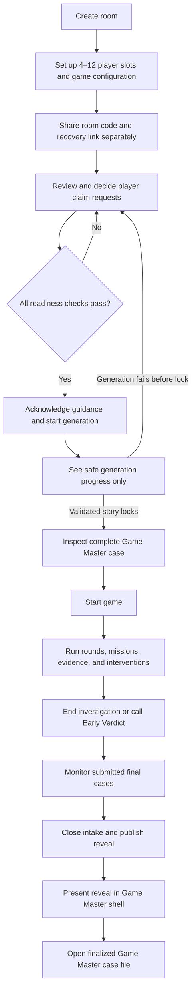
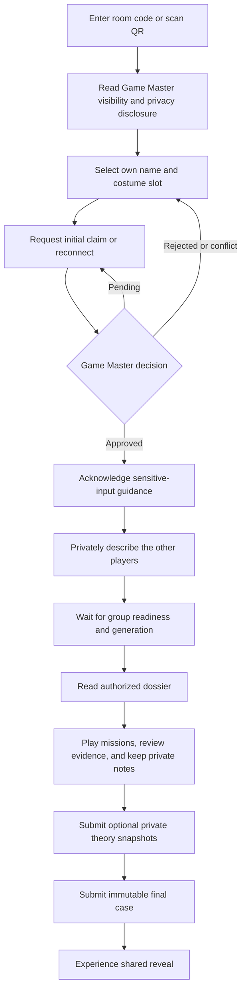

# Whodunit v0.1 MVP — UX Flow and Route Contract

**Status:** Implementation contract for UX-01

**Product:** Mobile-first, in-person murder mystery party game

**Source documents:** [requirements.md](./requirements.md) and
[technical-design.md](./technical-design.md)

**Last updated:** 2026-10-30

## 1. Purpose

This document maps the two Whodunit experiences across the complete room
lifecycle:

1. A dedicated, non-playing **Game Master** creates and runs the room.
2. **Players** claim a host-created identity and receive only their authorized
   player view.

It defines the actor, entry condition, exit condition, loading state, empty
state, failure and conflict recovery, and back-navigation behavior for every
MVP route. It is an information-architecture and interaction contract, not a
visual-design specification or a replacement for the server-side lifecycle and
authorization rules.

If this document and the source documents disagree, `requirements.md` is the
product source of truth and `technical-design.md` is the implementation source
of truth. Product decisions still called out as gates in `tasks.md` must not be
silently resolved in UI code.

## 2. Actors and Non-Negotiable Separation

### 2.1 Route actors

Every route belongs to exactly one of these actors:

| Actor | Meaning |
|---|---|
| Visitor | A session that has not yet received room authority. A pending player remains on a visitor-safe projection. |
| Game Master | The one current host principal for the room. The Game Master is not part of the 4–12-player count. |
| Player | A session with an ACTIVE membership bound to one internal player ID. |

The server resolves the actor before it returns an actor-specific projection or
renders private UI. Client-side hiding is not an authorization boundary.

### 2.2 The Game Master never receives player UI

The following is a hard product and implementation invariant:

> A current or former Game Master is never a player in the same room and never
> receives, enters, or briefly renders a player-only surface for that room.

Therefore:

- The Game Master never receives a player dossier, active-mission card,
  evidence inventory, detective notebook, theory form, accusation form, or
  personal player score of their own. The Game Master may inspect players'
  submitted gameplay results and scores as administrative case material.
- Game Master access to all generated dossiers, missions, evidence, submitted
  theories, and submitted final accusations after story lock appears as
  administrative case material inside the **Game Master shell**, not as
  player components or player routes.
- `/room/{roomId}/reveal` is a player route. During the shared reveal, the Game
  Master sees an equivalent synchronized presentation inside
  `/host/{roomId}/dashboard`; it is rendered as a Game Master dashboard mode.
- A current Game Master who opens a `/room/...` URL is server-redirected to the
  correct `/host/...` route before any player projection renders.
- A player who opens a `/host/...` URL receives a generic denial or is
  redirected to that player's current safe route. No host payload renders.
- A former Game Master whose authority was replaced cannot enter either the
  new Game Master view or a player view. The session receives a generic
  unavailable result and no room-private payload.
- Host recovery transfers only Game Master authority. It never creates,
  revokes, or transfers a player membership.

Actor resolution uses mutually exclusive Game Master and player principals on
the server and in the database. UI tests must also assert that the wrong shell
does not flash while a session is being restored.

## 3. Navigation Model

### 3.1 Mobile-first shells

The **Game Master shell** prioritizes room status, player readiness, the full
post-lock case, and state-changing controls. On a phone it uses a compact
overview with sticky primary controls; wider screens may add a persistent
case-navigation rail.

The **player shell** prioritizes one current objective and quick access to the
player's dossier, authorized evidence, and private notebook. The current
mission or current lifecycle action remains reachable without deep navigation.

Visitor pages use an actor-neutral shell. They must not use skeletons, labels,
or cached content that imply whether a guessed private room or player record
exists.

### 3.2 Server-first route resolution

On every room deep link, refresh, foreground return, and device reconnect, the
application resolves these facts in order:

1. Restore or create the anonymous device session.
2. Resolve current Game Master authority or ACTIVE player membership.
3. Fetch only that actor's current server projection.
4. Compare the requested route with the room state and actor capability.
5. Render the route, replace it with the actor's current default route, or fail
   closed with a generic unavailable state.
6. Subscribe to content-free Realtime invalidations after the authorized first
   fetch.

No actor-specific layout is rendered while steps 1–4 are unresolved.

### 3.3 Default route resolver

The default route is the safe destination after refresh, a stale deep link, a
completed mutation, or a lifecycle transition.

| Session and room condition | Default destination |
|---|---|
| No room authority | `/join` or the public landing page |
| New Game Master in DRAFT | `/host/{roomId}/setup` |
| Game Master in LOBBY | `/host/{roomId}/dashboard` |
| Game Master in GENERATING through REVEAL | `/host/{roomId}/dashboard` |
| Game Master in COMPLETED | `/host/{roomId}/case-file` |
| Visitor or pending claimant while the room accepts the requested claim type | `/room/{roomId}/claim` |
| ACTIVE player in LOBBY with required onboarding incomplete | `/room/{roomId}/describe` |
| ACTIVE player in LOBBY with onboarding complete | `/room/{roomId}/waiting` |
| ACTIVE player in GENERATING | `/room/{roomId}/waiting` |
| ACTIVE player in READY_TO_START | `/room/{roomId}/dossier` |
| ACTIVE player in IN_PROGRESS | `/room/{roomId}/mission` |
| ACTIVE player in FINAL_ACCUSATIONS with no submitted final case | `/room/{roomId}/accuse` |
| ACTIVE player in FINAL_ACCUSATIONS with a submitted final case | `/room/{roomId}/accuse` in immutable receipt mode |
| ACTIVE player in REVEAL or COMPLETED | `/room/{roomId}/reveal` |
| Current or former room Game Master attempting a player route | Current host route, or generic unavailable if no longer the current host |
| Revoked/replaced player membership | Generic access-moved state with a safe path to `/join` |
| Deleted room | Generic unavailable/expired state with no room metadata |

The exact room states in which initial claims, revocation, reconnect, and
replacement commands are enabled remain governed by the M0-03 product gate.
The route resolver uses server-returned capabilities and fails closed; the UI
must not infer permission from room state alone.

### 3.4 Back-navigation rules

These rules apply to all routes unless a route section overrides them:

- A successful lifecycle transition uses history replacement. Browser Back
  must not reopen an invalid form or an earlier room state.
- Actor changes, claim approval, device replacement, host recovery, reveal
  publication, and room completion also replace history.
- Back within a shell returns to a valid route for the same actor. It never
  crosses from the Game Master shell into the player shell or vice versa.
- If a browser history entry is now stale, route resolution replaces it with
  the current default route before rendering private content.
- A form with unsaved local input asks for confirmation before ordinary
  navigation. Server-saved drafts are restored on return.
- Raw descriptions and recovery secrets are never persisted to browser history
  or general-purpose client storage.

## 4. End-to-End Actor Journeys

### 4.1 Game Master journey

At no point does this journey enter a `/room/...` player route.

### 4.2 Player journey

Claiming a player identity never reveals or predetermines a faction. Story roles
exist only after the canonical story is successfully locked.

## 5. Room Lifecycle UX

### 5.1 Lifecycle map

| Room state | Entry | Game Master experience | Player experience | Exit |
|---|---|---|---|---|
| DRAFT | Room creation commits | Edit player slots and configuration; secure the recovery link | Room is not joinable; no player route or room-private data | Game Master finishes minimum valid setup and opens LOBBY, or abandoned-room cleanup deletes it under the final retention policy |
| LOBBY | Game Master finishes setup, or generation exhausts before lock | Manage setup, claims, readiness, consent, and generation action | Discover safe lobby; request a permitted claim/reconnect; approved players submit descriptions and wait | Game Master starts generation after all server readiness checks pass |
| GENERATING | Idempotent generation command commits | See safe stage/progress and retry/reconciliation status only; never draft or partial story output | Wait with safe progress only; no role, faction, or story content | Atomic story lock enters READY_TO_START; exhausted recovery returns to LOBBY without a story |
| READY_TO_START | Validated StoryPackage and `locked_at` commit atomically | Immediately inspect the complete canonical solution and all generated game material; start when ready | Read only the player's authorized dossier and any already-authorized content | Game Master starts the game |
| IN_PROGRESS | Start command commits | Run rounds, view the complete case, decide missions, release evidence/consequences, and approve interventions | Follow missions, review released/owned evidence, keep private notes, and submit optional theory snapshots | Game Master ends the final investigation round or calls Early Verdict |
| FINAL_ACCUSATIONS | Investigation ends or Early Verdict commits | Monitor who has submitted and view submitted snapshots, never drafts; close and publish when allowed | Draft and submit one private final case; submitted snapshot is immutable and receives no correctness feedback | Game Master closes intake, deterministic scoring runs, and reveal is published transactionally |
| REVEAL | Reveal publication commits | Present the shared conclusion inside the Game Master shell while retaining full case context | Experience the cinematic shared conclusion and results on the player reveal route | Case-file finalization completes and room enters COMPLETED |
| COMPLETED | Final case file and completion timestamp commit | Use the Game Master-only chronological case file | Revisit the shared reveal and authorized player-owned history | Retention cleanup deletes all room-scoped data 30 days after completion |
| Deleted | Retention or abandoned-room cleanup removes the room | Generic unavailable/expired result; no residual case metadata | Generic unavailable/expired result; no residual slot or story metadata | Public create or join flow for another room |

`REVEAL` may be short-lived when scoring and case-file assembly finish quickly.
Clients must still render it correctly and must not assume that publication and
completion arrive in the same response.

### 5.2 Route availability by lifecycle

Legend: **P** = default/primary route, **S** = valid secondary route,
**W** = safe waiting or transitional route, **R** = redirect to the actor's
default route, and **—** = unavailable to that actor/state.

#### Game Master routes

| Route | DRAFT | LOBBY | GENERATING | READY | IN PROGRESS | FINAL | REVEAL | COMPLETED |
|---|---:|---:|---:|---:|---:|---:|---:|---:|
| `/host/{roomId}/setup` | P | S | R | R | R | R | R | R |
| `/host/{roomId}/claims` | — | S | S | S | S | S | S | S |
| `/host/{roomId}/dashboard` | R | P | P | P | P | P | P | R |
| `/host/{roomId}/case-file` | — | — | — | — | — | — | W | P |

The claims page may remain inspectable so the Game Master can see slot and
connection status. Which claim-management actions are enabled comes only from
server capabilities and the finalized M0-03 policy.

#### Player and visitor-safe routes

| Route | DRAFT | LOBBY | GENERATING | READY | IN PROGRESS | FINAL | REVEAL | COMPLETED |
|---|---:|---:|---:|---:|---:|---:|---:|---:|
| `/room/{roomId}/claim` | — | P | W | W | W | W | — | — |
| `/room/{roomId}/describe` | — | P | R | R | R | R | R | R |
| `/room/{roomId}/waiting` | — | P | P | R | R | R | R | R |
| `/room/{roomId}/dossier` | — | — | — | P | S | S | S | S |
| `/room/{roomId}/mission` | — | — | — | — | P | S | S | S |
| `/room/{roomId}/evidence` | — | — | — | S | S | S | S | S |
| `/room/{roomId}/notebook` | — | — | — | S | S | S | S | S |
| `/room/{roomId}/accuse` | — | — | — | — | — | P | R | R |
| `/room/{roomId}/reveal` | — | — | — | — | — | — | P | P |

`/room/{roomId}/claim` is always visitor-safe. A reconnect request may be
available after LOBBY only when the server exposes that capability under the
final M0-03 rules; the route never gains player-private content while the
request is pending. Later-state secondary routes show only the active player's
own or released retained history and never broaden authorization.

## 6. Shared Screen-State Contract

Every route implements these states even when a route-specific section calls a
state “not normally expected.”

### 6.1 Loading and session restoration

- Show an actor-neutral shell until session and room authority are resolved.
- After actor resolution, show a route-specific skeleton with an accessible
  loading label.
- Never display last-room private data while a new room or actor projection is
  loading.
- A refresh restores the server session and projection; it does not ask an
  ACTIVE player to select a name again.
- Generation loading shows only safe job stages. It never streams prompts,
  model output, validation details, or partial story data.

### 6.2 Valid empty states

- Empty states explain whether there is nothing to do yet, all work is done, or
  an action is unavailable in the current state.
- They provide one safe next action, such as “Share room code,” “Check setup,”
  “Wait for the Game Master,” or “Return to current mission.”
- An unexpected absence of required post-lock data is not shown as a cheerful
  empty state. It is an integrity error and offers a safe refetch.

### 6.3 Errors

- Messages use stable, non-sensitive error categories and never confirm that a
  guessed private room UUID, role, claim, or secret exists.
- Failed reads may retry automatically with bounded backoff and always offer a
  manual retry.
- Failed commands never pretend to succeed. The action remains uncommitted and
  requires an explicit retry unless an idempotency receipt proves it committed.
- Database or network failures keep the last successfully fetched projection
  visibly marked as stale; state-changing controls are disabled until the
  server confirms current state.

### 6.4 Conflicts and duplicate actions

- A `409` or newer `state_version` triggers a projection refetch before the
  action is offered again.
- An idempotent duplicate returns the first committed result and routes from
  that result; it does not show a false failure.
- Claim and device-replacement conflicts return to safe slot status without
  disclosing the winning session.
- Revision conflicts on notebook or draft saves preserve the user's unsaved
  text in memory, refetch the authoritative revision, and require an explicit
  merge or retry. The client never silently overwrites newer text.

### 6.5 Realtime disconnect and recovery

- Show a persistent but non-blocking “Reconnecting” indicator with the last
  synchronized time or state version.
- Refetch after subscription establishment, foreground return, and network
  reconnect; use a slow safety poll during active play.
- Realtime messages are content-free invalidations. All content comes from a
  newly authorized fetch.
- Presence may become stale during a disconnect. It never revokes membership
  or changes authorization.
- When Realtime remains unavailable, polling preserves correctness and the game
  can continue.

### 6.6 Authority loss, expiration, and privacy

- A replaced player device loses private access on its next request. Clear the
  room projection from memory and show “Access moved to another device” with a
  route to `/join`.
- A replaced Game Master session clears all host case data and receives a
  generic authority-lost result.
- A deleted room returns the same generic unavailable shape as another
  non-disclosive lookup failure. If expiration is already known from the
  current session, the UI may explain the 30-day policy without returning room
  details.
- Authenticated room routes are dynamically rendered and never use shared
  response caches.

## 7. Public and Recovery Routes

### 7.1 `/create` — Create Room

- **Actor:** Visitor eligible to become the initial Game Master of a new room.
- **Entry:** Public landing action “Create a mystery.” Anonymous session
  bootstrap begins before the create command.
- **Primary content:** A concise explanation that the creator is a dedicated,
  non-playing Game Master, followed by the create action.
- **Exit:** Successful room creation replaces the route with
  `/host/{roomId}/setup` and presents the room code and recovery credential in
  their appropriate separate contexts.
- **Loading:** Disable duplicate creation, announce progress, and use one
  idempotency key for retries.
- **Empty:** The untouched create form is the valid empty state.
- **Error/conflict:** Keep the user on the form with a retry. If an idempotent
  retry finds that creation already committed, use the original room result.
- **Recovery:** A restored session with an already-created room may continue to
  that room's current Game Master default route; it never joins a player route.
- **Back:** Returns to the public landing page. After creation, Back cannot
  replay room creation.

### 7.2 `/join` — Join Room

- **Actor:** Visitor. An existing player may also arrive here before server
  resolution redirects the session.
- **Entry:** Public landing action, invitation link, or QR code fallback.
- **Primary content:** Case-insensitive six-character room-code entry.
- **Exit:** A joinable lookup replaces the route with
  `/room/{roomId}/claim`. An ACTIVE player is instead routed to the current
  player default; a current Game Master is routed to the Game Master default.
- **Loading:** Submit once, keep the entered code visible, and use an
  actor-neutral lookup state.
- **Empty:** Blank room-code form with format guidance.
- **Error/conflict:** Invalid, unavailable, rate-limited, and non-joinable codes
  use non-enumerating messages. Do not reveal room lifecycle or player names.
- **Recovery:** Network retry repeats only the lookup. It does not create a
  claim. Restored membership bypasses name selection.
- **Back:** Returns to the public landing page.

### 7.3 `/host/recover` — Exchange Game Master Recovery Link

This route is the proposed client entry for the recovery-link exchange defined
by the technical design. A final pathname change does not change this contract.

- **Actor:** Visitor seeking to become the replacement Game Master. The
  principal must be clean for this room: never a player, claimant, current Game
  Master, or former Game Master.
- **Entry:** High-entropy recovery secret delivered in the URL fragment.
- **Primary content:** A minimal confirmation/exchange screen with no story or
  lobby data.
- **Exit:** Successful atomic exchange rotates the secret, replaces history,
  removes the fragment, and routes to setup before lock or the Game Master
  dashboard/case file after lock.
- **Loading:** Show only “Recovering Game Master access.” Never echo the token,
  room code, player names, or story state.
- **Empty:** Missing or already-removed fragment shows a generic invalid-link
  state and guidance to use a valid saved link.
- **Error/conflict:** Invalid, used, expired, ineligible-principal, and
  concurrent-recovery failures use a non-sensitive result. No host projection
  is returned by the exchange itself.
- **Recovery:** A network-ambiguous exchange checks the current principal's
  authority before offering another exchange, because the first request may
  have committed and rotated the token.
- **Back:** Cannot restore the secret or replay recovery. A completed exchange
  always resolves through the current Game Master default route.

## 8. Game Master Routes

### 8.1 `/host/{roomId}/setup` — Player and Game Configuration

- **Actor:** Current Game Master only.
- **Entry:** Room creation in DRAFT, or Game Master navigation while setup is
  still editable in LOBBY.
- **Primary content:** 4–12 player slots excluding the Game Master; names,
  costumes, optional background; duration; faction counts; murderer awareness;
  consent/readiness validation; room-code sharing.
- **Exit:** “Finish setup” enters LOBBY. “Review readiness” routes to the
  dashboard. Successful generation makes setup immutable and replaces this
  route with the dashboard.
- **Loading:** Actor-safe setup skeleton followed by the authoritative saved
  form. Do not render cached setup from another room.
- **Empty:** New room with the first blank player slot and clear minimum of four
  players. The Game Master is never offered as a slot.
- **Error/conflict:** Field validation stays inline. A stale revision refetches
  before resubmission. A generation/state conflict routes to the dashboard
  without restoring editable controls.
- **Recovery:** Saved server state survives refresh and host recovery. Unsaved
  local fields require confirmation before navigation and are not claimed to
  have persisted.
- **Back:** Returns to the Game Master home/dashboard when available; in a new
  DRAFT it may return to the public landing page after an unsaved-change
  warning. It never deletes the room implicitly.

### 8.2 `/host/{roomId}/claims` — Claims and Device Bindings

- **Actor:** Current Game Master only.
- **Entry:** “Manage players” from setup or dashboard. The route is useful from
  LOBBY onward for slot, pending-request, membership, and presence status.
- **Primary content:** Initial and reconnect requests, name plus costume,
  unclaimed/pending/active status, best-effort connected/disconnected status,
  and server-authorized approve/reject/revoke/replace actions.
- **Exit:** After a decision, remain on the updated list; “Done” returns to the
  referring Game Master route. Readiness changes are reflected on dashboard.
- **Loading:** Slot-shaped placeholders without request details until the
  GameMasterClaimsView is authorized.
- **Empty:** “No pending requests” plus current slots, invite action, and
  readiness summary. No pending requests is not an error.
- **Error/conflict:** Simultaneous approval, slot occupation, state change, or
  host recovery produces a refetch. Never disclose the other device identity.
  An old Game Master losing authority clears the view immediately.
- **Recovery:** Realtime loss falls back to polling. Device replacement keeps
  all player progress on `player_id`; UI confirmation explicitly warns that
  the old device will lose access.
- **Back:** Returns to setup before lock when that was the entry, otherwise the
  Game Master dashboard. It never opens a player's claim page.

Which mutations are enabled in each lifecycle state is server-provided and is
finalized by M0-03. A disabled action explains that it is unavailable now but
does not expose private policy or session identifiers.

### 8.3 `/host/{roomId}/dashboard` — Game Master Control Center

- **Actor:** Current Game Master only.
- **Entry:** Game Master home from LOBBY through REVEAL; route resolution after
  story lock, generation updates, game actions, or recovery.
- **Primary content by state:**
  - **LOBBY:** Setup, claim, consent, and description readiness; generate only
    when the server says ready.
  - **GENERATING:** Safe job progress, background/reconciliation status, and no
    model or partial-story output.
  - **READY_TO_START:** Complete canonical solution, all generated dossiers,
    roles, missions, evidence, interventions, and ending; start-game control.
  - **IN_PROGRESS:** Complete case plus player presence, round controls,
    mission decisions, consequences, evidence, interventions, submitted theory
    snapshots, and Early Verdict.
  - **FINAL_ACCUSATIONS:** Full case plus submitted-case roster and submitted
    snapshots; no notebook, theory, or accusation drafts.
  - **REVEAL:** Game Master-owned shared-reveal presentation, results, and
    case-file finalization status.
- **Exit:** State commands keep the Game Master on the refreshed dashboard.
  Completion replaces it with `/host/{roomId}/case-file`. DRAFT redirects to
  setup.
- **Loading:** Before lock, show only setup/readiness-safe placeholders. During
  GENERATING, show safe stages. After lock, withhold the entire case until the
  complete authorized projection loads; never blend old and new versions.
- **Empty:** State-specific examples include no pending claims, no mission
  decisions, no released events, no submitted theories, or no final
  submissions yet. Missing canonical sections after lock are integrity errors,
  not empty states.
- **Error/conflict:** A stale host command returns `409`, refetches, and offers
  only actions valid in the new version. Double taps resolve through the
  idempotency receipt. Intervention failure stages the deterministic fallback.
  Database failure disables mutation controls.
- **Recovery:** Refresh and Realtime reconnect restore the full current
  projection. Generation exhaustion returns the room to LOBBY with no story
  locked and a safe retry path. Host-device loss uses the separate recovery
  route.
- **Back:** This is the Game Master home. Internal case sections use same-shell
  navigation. Browser Back may leave the room or return to setup/claims only
  when still valid; it never reaches player history.

### 8.4 `/host/{roomId}/case-file` — Complete Game Master Case File

- **Actor:** Current Game Master only.
- **Entry:** Completion redirect, or Game Master return to a retained COMPLETED
  room. During REVEAL the route may show a finalization wait state.
- **Primary content:** Complete chronological narrative, every generated
  character and secret, canonical solution, clues and explanations, generated
  missions and consequences, actual runtime events, submitted theory
  snapshots, submitted final accusations, scores, and outcomes.
- **Exit:** Remains the postgame Game Master home until deletion. The Game
  Master may navigate within case-file sections but not into player views.
- **Loading:** Show case-file structure only after current Game Master
  authorization. During finalization, show safe progress and poll/refetch.
- **Empty:** Before finalization, “Preparing case file” is valid. Missing
  required content after COMPLETED is an integrity error.
- **Error/conflict:** Refetch on a newer state version. If completion is still
  committing, remain in the wait state. If deleted, clear all case data and
  show the generic expired result.
- **Recovery:** Host recovery on another device returns the same authorized
  case file. No recovery token or raw source description appears in it.
- **Back:** Returns to a host-shell reveal summary or leaves the room; it cannot
  reopen final-submission controls or a player reveal route.

## 9. Player Routes

### 9.1 `/room/{roomId}/claim` — Safe Lobby and Claim Request

- **Actor:** Visitor or pending claimant only. It never uses PlayerView.
- **Entry:** Successful safe room-code lookup, invitation link, or reconnect
  request from a new device when the server permits it.
- **Primary content:** Safe room metadata; all host-created slots with name,
  costume, and available/occupied state; dedicated Game Master visibility
  disclosure; owner-only draft distinction; claim/reconnect request status.
- **Exit:** Approval replaces the route with description onboarding in LOBBY or
  the current player default for a later reconnect. Rejection returns to safe
  slot selection. The route never reveals a faction.
- **Loading:** Safe-lobby skeleton without names until lookup succeeds. Pending
  approval polling/Realtime shows only request status.
- **Empty:** No selectable available slot offers reconnect only where the
  server permits it and otherwise says to ask the Game Master. No slot list at
  all is treated as unavailable, not as proof of an empty private room.
- **Error/conflict:** Concurrent claim approval, newly occupied slot, rejected
  request, or stale room state refetches safe metadata. No occupying session is
  exposed. Current and former room Game Masters receive generic unavailable.
- **Recovery:** Refresh restores pending status from the anonymous session. If
  browser storage is lost, the device starts a new RECONNECT request and gains
  no private access until Game Master approval.
- **Back:** Returns to `/join`. Leaving does not imply approval or cancellation;
  a pending request remains pending until resolved under the server policy.

### 9.2 `/room/{roomId}/describe` — Private Player Descriptions

- **Actor:** ACTIVE player only.
- **Entry:** Claim approval in LOBBY or return while the player's required
  description onboarding is incomplete.
- **Primary content:** Sensitive-input/fictional-use acknowledgment followed by
  one prompt for each required other player. Raw text and authorship are
  owner/source data, not Game Master or peer-visible gameplay state.
- **Exit:** When the server's finalized completeness rule is satisfied, replace
  the route with `/room/{roomId}/waiting`.
- **Loading:** Restore completed prompt status from the server without exposing
  another player's authored text. Do not prefill from shared browser storage.
- **Empty:** No remaining required prompts means onboarding is complete and the
  route redirects to waiting. Exact skip/decline behavior remains governed by
  the M0-02 product gate.
- **Error/conflict:** Per-subject save errors preserve the unsent field only in
  page memory and offer retry. If generation starts or lifecycle changes before
  a save, refetch and route to waiting; never reopen source input after lock.
- **Recovery:** Completed server submissions survive refresh and approved
  device replacement. Raw input is purged after story lock according to the
  privacy workflow and never appears in generated output verbatim.
- **Back:** Returns to waiting/readiness status with a warning for an unsaved
  field. It never returns to name selection for an ACTIVE player.

### 9.3 `/room/{roomId}/waiting` — Lobby and Generation Wait

- **Actor:** ACTIVE player only.
- **Entry:** Description completion, direct refresh during LOBBY or GENERATING,
  or generation failure returning the group to LOBBY.
- **Primary content:** Safe arrival/submission readiness and Game Master-driven
  next step. During GENERATING, show safe progress only.
- **Exit:** Atomic story lock replaces the route with
  `/room/{roomId}/dossier`. If onboarding becomes incomplete under the
  authoritative rule, route to describe.
- **Loading:** Restore membership, readiness, and lifecycle before showing room
  status. Do not show role-shaped placeholders during generation.
- **Empty:** “Everyone is ready; waiting for the Game Master” is a valid success
  state. No story content yet is expected, not an error.
- **Error/conflict:** Generation exhaustion explains that no story was locked
  and the Game Master can retry. Network/Realtime failure shows reconnecting and
  polls. A replaced membership clears the screen.
- **Recovery:** Refresh stays bound to the same player ID. Realtime signals
  trigger authorized refetch; polling covers missed signals.
- **Back:** Returns to describe only while the server reports incomplete
  onboarding. Otherwise the route is the player's pre-game home and Back may
  leave the room without dropping membership.

### 9.4 `/room/{roomId}/dossier` — Authorized Character Dossier

- **Actor:** ACTIVE player only.
- **Entry:** First post-lock destination in READY_TO_START, player-shell
  navigation later, or refresh of a retained room.
- **Primary content:** Only the player's server-authorized role, background,
  secrets, relationships, and release-conditioned faction knowledge.
- **Exit:** “Ready” remains in the waiting/start state until the Game Master
  starts; after start, current-objective navigation goes to mission.
- **Loading:** Private skeleton only after player authority resolves. Do not
  cache or render a prior player's dossier.
- **Empty:** A missing dossier after story lock is an integrity error with
  refetch; it is never shown as “no character.”
- **Error/conflict:** State change refetches the player projection. Revoked or
  replaced membership clears all dossier data immediately.
- **Recovery:** Refresh and approved device replacement retrieve the same
  dossier by `player_id`. No role is regenerated.
- **Back:** Returns to the current player home for the lifecycle state, never to
  claim selection. In postgame, Back returns to the player reveal summary.

### 9.5 `/room/{roomId}/mission` — Current Objective

- **Actor:** ACTIVE player only.
- **Entry:** Game start, round change, or player-shell “Mission” navigation.
- **Primary content:** Current achievable objective, success criteria, visible
  stakes before acceptance, deadline guidance, status, and completion request.
- **Exit:** Remain on refreshed status after accept or completion request; a
  round transition replaces the current objective; FINAL_ACCUSATIONS routes to
  accuse.
- **Loading:** Load the actor-authorized current-round mission after resolving
  the state version.
- **Empty:** “No active objective right now” is valid when all current missions
  are resolved or none is released; show the current round and evidence link.
- **Error/conflict:** A stale completion request refetches current status. A
  duplicate request returns the original result. The UI never declares success
  until the Game Master decision commits.
- **Recovery:** Mission state survives refresh and approved device replacement.
  Realtime loss uses polling and does not block in-person play.
- **Back:** Returns to the current player home/current round, not the previous
  round's actionable mission. Historical missions may be read-only secondary
  content.

### 9.6 `/room/{roomId}/evidence` — Authorized Evidence Board

- **Actor:** ACTIVE player only.
- **Entry:** Player-shell navigation from READY_TO_START onward, or a released
  evidence notification.
- **Primary content:** Public released evidence plus private clues authorized
  for this player, clearly labeled without implying unreleased items.
- **Exit:** Evidence selection may return to mission, notebook, theory, or final
  accusation within the same player shell.
- **Loading:** Render no evidence text until the current authorized projection
  arrives.
- **Empty:** “No evidence has been released to you yet” is valid. Do not expose
  the count or shape of unreleased evidence.
- **Error/conflict:** Newer releases trigger refetch. A stale item link returns
  to the board without revealing whether an unauthorized item exists.
- **Recovery:** Released/owned evidence is reconstructed from the server after
  refresh or approved device replacement.
- **Back:** Returns to the prior valid player route; after lifecycle change it
  resolves to the current default route.

### 9.7 `/room/{roomId}/notebook` — Private Notebook and Theories

- **Actor:** ACTIVE player only.
- **Entry:** Player-shell navigation from READY_TO_START through retained
  postgame access.
- **Primary content:** Owner-only notes, suspect selections, and unsubmitted
  theory prose; explicit action to submit a fixed theory snapshot during an
  allowed investigation round.
- **Exit:** Saving remains on the notebook. Submitting a theory confirms that
  the fixed snapshot becomes Game Master-visible and returns no correctness
  feedback. Lifecycle transitions route to the relevant player default.
- **Loading:** Restore the owner's notebook by `player_id` only after active
  membership authorization.
- **Empty:** Blank notebook with a private-to-you explanation and prompts. This
  is a valid state.
- **Error/conflict:** Expected-revision conflict preserves unsaved local text,
  fetches the server version, and asks the player to reconcile. Never silently
  overwrite or send notebook prose to the intervention model.
- **Recovery:** Server-saved notes survive refresh and approved device
  replacement. They remain hidden from peers and the Game Master for the room
  lifetime; only explicitly submitted snapshots enter Game Master-visible
  state.
- **Back:** Returns to mission/evidence or the current player default. An
  unsaved local edit prompts before leaving. It never routes to a Game Master
  case view.

### 9.8 `/room/{roomId}/accuse` — Final Case

- **Actor:** ACTIVE player only.
- **Entry:** Room enters FINAL_ACCUSATIONS through normal progression or Early
  Verdict.
- **Primary content:** Suspected murderers and accomplices, motive, method,
  released supporting evidence, optional explanation, and clear draft versus
  submitted privacy.
- **Exit:** Submission creates one immutable snapshot and changes the route to
  receipt/waiting mode. Reveal publication replaces the route with
  `/room/{roomId}/reveal`.
- **Loading:** Restore the owner-only draft or submitted receipt. Do not show
  another player's submission status beyond safe aggregate progress.
- **Empty:** Blank final-case draft with all required fields explained.
- **Error/conflict:** Draft revision conflict uses explicit reconciliation.
  Submission is idempotent. If intake closed or reveal published first, refetch
  and route to receipt/reveal without pretending a late draft submitted.
- **Recovery:** Server-saved draft survives refresh and approved replacement;
  only the submitted snapshot is Game Master-visible. No automatic correctness
  feedback is shown.
- **Back:** Before submission, returns to evidence/notebook with the saved draft
  intact. After submission, Back cannot reopen an editable version. After
  reveal, stale history redirects to reveal.

### 9.9 `/room/{roomId}/reveal` — Player Reveal and Results

- **Actor:** ACTIVE player only. This is not the Game Master reveal surface.
- **Entry:** Game Master publishes the reveal, or player returns to a retained
  REVEAL/COMPLETED room.
- **Primary content:** Shared dramatic solution, murderers, accomplices, motive,
  method, decisive clues, conspiracy, faction outcome, and authorized results.
- **Exit:** Remains the player's postgame home until deletion. Secondary links
  may revisit that player's own retained dossier, mission history, released
  evidence, and private notebook without granting new access.
- **Loading:** Use a reveal-safe presentation shell after player authority
  resolves. Never leak canonical facts before the publication state commits.
- **Empty:** Published reveal without required canonical content is an
  integrity error, not an empty result.
- **Error/conflict:** A client arriving during finalization refetches/polls.
  Expiration clears retained data and shows the generic expired result.
- **Recovery:** Refresh and approved device replacement return to the same
  published result. Realtime is optional after completion; authorized reads
  remain the source of truth.
- **Back:** Cannot reopen the final-accusation editor. It returns to a valid
  player-owned postgame section or leaves the room.

## 10. Cross-Route Recovery Scenarios

| Scenario | Required UX behavior | Safe destination |
|---|---|---|
| Browser refresh | Restore anonymous session, resolve actor, fetch current projection, then render | Actor's current default route |
| Temporary network loss | Mark view stale/reconnecting, disable mutations, refetch and poll | Same route if still valid |
| Missed or duplicate Realtime signal | Compare `state_version`; refetch on newer version; ignore duplicates | Same or newly resolved default route |
| Stale command (`409`) | Discard optimistic state, fetch authoritative projection, explain changed state | Current valid Game Master/player route |
| Ambiguous command response | Retry with the same idempotency key; accept original receipt if committed | Route implied by committed result |
| Two claims for one slot | Only one approval can commit; other request returns safe conflict | Safe claim selection/pending view |
| Player changes device | New device remains visitor-safe until approved; approval revokes old membership and preserves `player_id` state | New device's current player default; old device's access-moved state |
| Game Master changes device | Exchange and rotate recovery secret using a clean principal; old principal loses authority | Current Game Master default route |
| Story API timeout | Keep safe generation progress while background/reconciliation continues | Game Master dashboard/player waiting |
| Generation validation exhausted | Lock nothing, return room to LOBBY, explain retry is available to Game Master | Game Master dashboard/player waiting |
| Live intervention failure | Stage eligible pre-generated fallback for Game Master approval | Game Master dashboard |
| Database unavailable | Never claim a command succeeded; retry reads and require explicit command retry | Same route with stale marker |
| Reveal finalizing | Show actor-specific wait state and refetch until completion | Player reveal or Game Master case file |
| Room deleted | Clear room data and use non-enumerating unavailable/expired result | Public landing/create/join |

## 11. Information Exposure by Surface

| Information | Visitor/pending claim | Player surface | Game Master surface |
|---|---:|---:|---:|
| Safe names, costumes, available/occupied status | Yes | Yes | Yes |
| Raw friend descriptions or authorship | No | Only the author's own source-entry flow before purge | No |
| Generated dossier, faction, secrets, missions | No | Own authorized content only | All after story lock |
| Released public evidence | No | Yes | Yes |
| Another player's private generated content | No | No | Yes after story lock |
| Notebook drafts and unsubmitted theory prose | No | Owner only | No |
| Submitted theory snapshot | No | Owner only | Yes |
| Final-accusation draft | No | Owner only | No |
| Submitted final accusation | No | Owner only before reveal | Yes |
| Canonical solution | No | Reveal only | Yes immediately after story lock |
| Recovery/authentication secrets | No | No | Recovery credential handled separately; never in the Game Master projection |

The Game Master visibility disclosure is shown before a visitor requests a
slot. The description guidance is acknowledged before private source text is
submitted. The host guidance and room-consent confirmation are acknowledged
before generation begins.

## 12. Accessibility and In-Person Play Constraints

- All primary controls have large touch targets and remain usable on narrow
  mobile screens.
- Focus moves to the new state heading after route replacement, conflict
  recovery, or lifecycle transition.
- Loading, reconnecting, command success, error, and timer guidance are
  announced without relying on color.
- Duplicate display names are always paired with costume and never used as an
  identifier.
- Names and player-provided text are Unicode-safe and layouts tolerate long
  content.
- Private content is not exposed in notification text, page titles, or lock
  screen previews by default.
- Timers communicate target pacing only; they never advance the game
  automatically.
- The player shell keeps the phone secondary to conversation: current objective
  first, short actions, no forced continuous screen attention.

## 13. UX-01 Verification Checklist

Implementation is conformant only when all of the following are true:

- [ ] Every route in this document has exactly one actor and a server-enforced
  entry condition.
- [ ] Every route implements its stated exit, loading, empty, error/conflict,
  recovery, and back-navigation behavior.
- [ ] All DRAFT, LOBBY, GENERATING, READY_TO_START, IN_PROGRESS,
  FINAL_ACCUSATIONS, REVEAL, COMPLETED, and deleted-room conditions resolve to a
  safe actor route.
- [ ] A current or former Game Master can never claim a player, receive a
  PlayerView DTO, enter a player route, or flash a player component.
- [ ] The shared reveal uses separate actor surfaces: player reveal route and
  Game Master dashboard reveal mode.
- [ ] Wrong-actor and stale deep links fail closed before private rendering.
- [ ] Refresh, device replacement, host recovery, Realtime disconnect, `409`
  conflict, duplicate command, generation failure, and deletion have tested
  recovery paths.
- [ ] Room code lookup and pending claims expose only safe lobby information.
- [ ] Owner-only drafts never appear in Game Master UI, Realtime payloads,
  shared caches, or intervention context.
- [ ] No partial, invalid, or repairing story content appears during
  GENERATING.
- [ ] Lifecycle transitions replace invalid browser history and never reopen a
  closed form.
- [ ] The experience remains accessible, mobile-first, and usable while
  Realtime falls back to polling.
